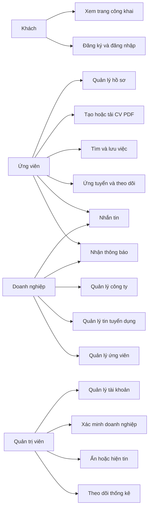
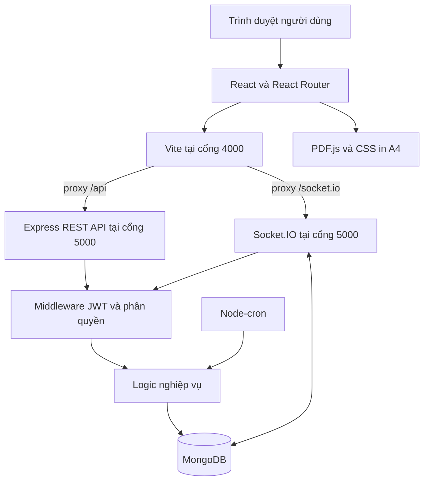
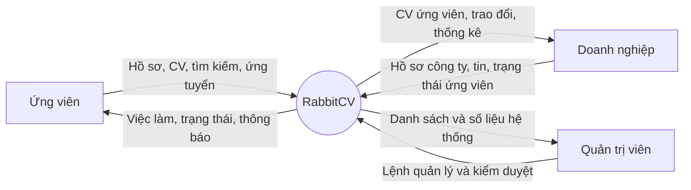
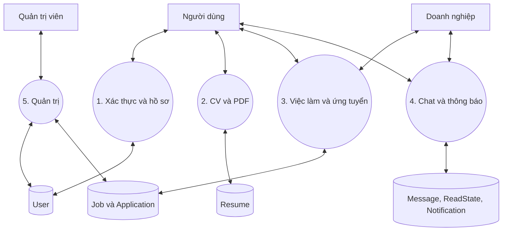
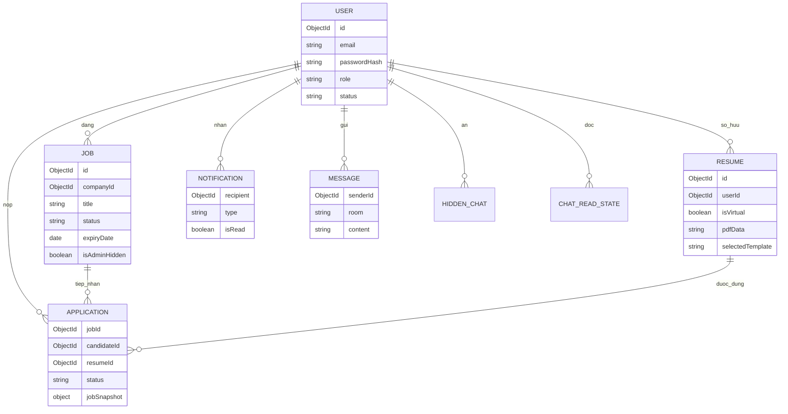
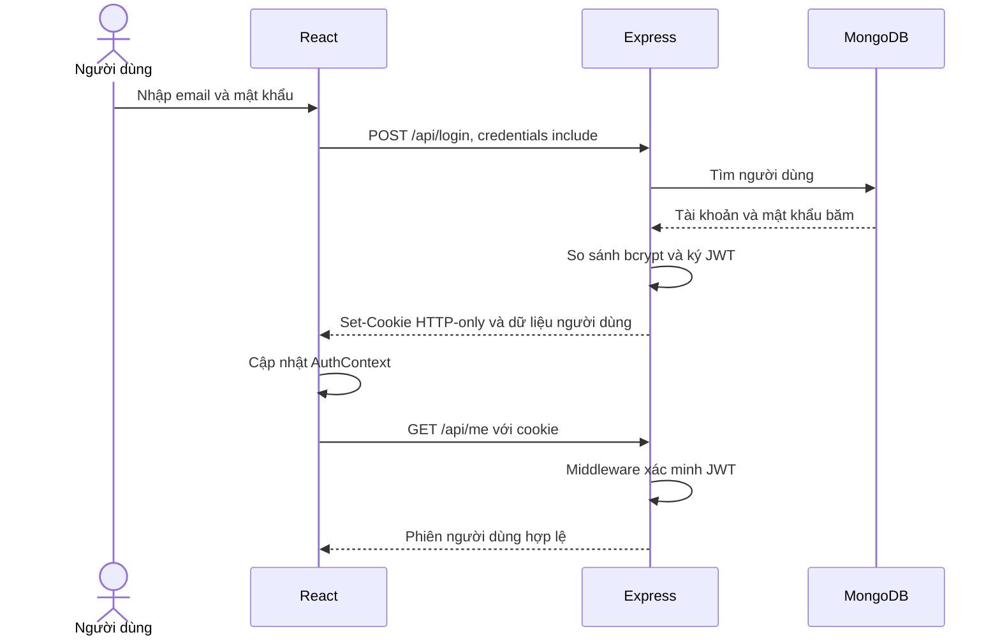
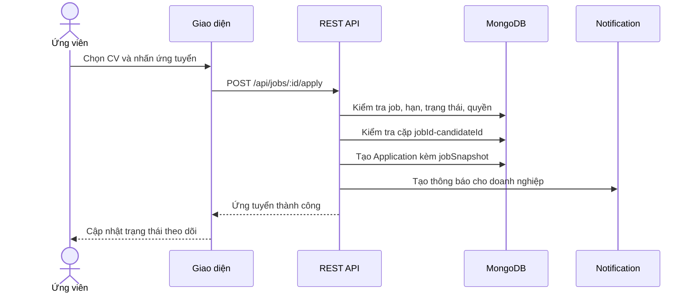
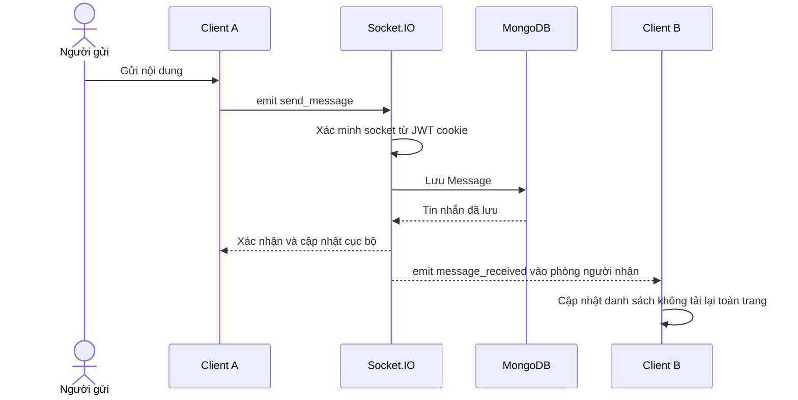
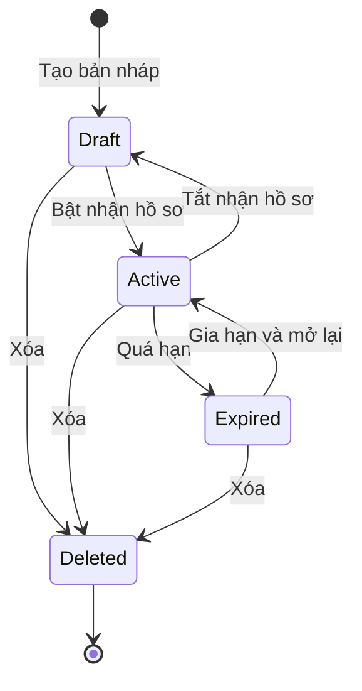

# LỜI CAM ĐOAN

Tôi cam đoan báo cáo đồ án tốt nghiệp với đề tài **RabbitCV - Nền tảng hỗ trợ viết CV và tìm kiếm việc làm** là kết quả nghiên cứu, phân tích, thiết kế và triển khai của cá nhân tôi dưới sự hướng dẫn của ThS. Mai Đức Trung. Các nội dung tham khảo được trích dẫn trong danh mục tài liệu tham khảo. Những số liệu kiểm thử và mô tả kỹ thuật trong báo cáo được tổng hợp từ phiên bản mã nguồn của hệ thống tại thời điểm hoàn thành báo cáo.

Tôi chịu trách nhiệm về tính trung thực của nội dung đã trình bày. Những hạn chế của sản phẩm được nêu rõ nhằm phản ánh đúng phạm vi một đồ án cá nhân và làm cơ sở cho hướng phát triển tiếp theo.

[PAGEBREAK]

# LỜI CẢM ƠN

Trong quá trình thực hiện đồ án, tôi đã nhận được nhiều sự hướng dẫn và hỗ trợ quý báu. Trước hết, tôi xin bày tỏ lòng biết ơn chân thành đến ThS. Mai Đức Trung, giảng viên hướng dẫn, người đã góp ý về định hướng đề tài, phương pháp triển khai và cách trình bày kết quả một cách có hệ thống.

Tôi xin cảm ơn quý thầy cô Khoa Khoa học và Kỹ thuật Máy tính, Trường Đại học Bách Khoa - Đại học Quốc gia Thành phố Hồ Chí Minh đã trang bị nền tảng kiến thức về lập trình, cơ sở dữ liệu, công nghệ phần mềm và hệ thống thông tin. Những kiến thức đó là cơ sở để tôi có thể xây dựng một ứng dụng web toàn ngăn xếp có nhiều vai trò người dùng và nhiều quy trình nghiệp vụ liên quan.

Tôi cũng xin cảm ơn gia đình, bạn bè và những người đã góp ý trong quá trình trải nghiệm thử giao diện RabbitCV. Các phản hồi về kích thước, bố cục CV, quy trình ứng tuyển, thông báo và nhắn tin đã giúp sản phẩm được điều chỉnh gần hơn với nhu cầu sử dụng thực tế.

Do giới hạn về thời gian, nguồn lực và phạm vi của một đồ án cá nhân, hệ thống chắc chắn vẫn còn những điểm cần hoàn thiện. Tôi trân trọng tiếp thu các ý kiến phản biện để tiếp tục cải tiến sản phẩm trong tương lai.

[PAGEBREAK]

# TÓM TẮT

RabbitCV là nền tảng web hỗ trợ người tìm việc xây dựng hồ sơ nghề nghiệp, tạo CV theo mẫu, tải CV từ máy tính, tìm kiếm và lưu tin tuyển dụng, nộp hồ sơ, theo dõi trạng thái ứng tuyển và trao đổi với doanh nghiệp. Hệ thống đồng thời cung cấp cổng dành cho doanh nghiệp để quản lý hồ sơ công ty, đăng và điều chỉnh tin tuyển dụng, tiếp nhận ứng viên, cập nhật trạng thái xử lý và nhắn tin. Vai trò quản trị viên được bổ sung nhằm theo dõi số liệu tổng quan, quản lý người dùng, doanh nghiệp và nội dung tuyển dụng.

Giải pháp được phát triển theo kiến trúc MERN. Giao diện sử dụng React, Vite và Tailwind CSS; máy chủ sử dụng Node.js và Express; dữ liệu được lưu trong MongoDB thông qua Mongoose. REST API đảm nhiệm phần lớn hoạt động nghiệp vụ. Socket.IO được dùng cho nhắn tin thời gian thực, trong khi thông báo sử dụng cơ chế truy vấn định kỳ kết hợp tác vụ theo lịch. JWT được lưu trong cookie HTTP-only để duy trì phiên đăng nhập. Vite proxy chuyển tiếp các đường dẫn `/api` và `/socket.io` đến máy chủ phát triển tại cổng 5000.

Một trọng tâm của đồ án là xử lý CV ở hai nguồn. CV tạo trên web được lưu theo cấu trúc dữ liệu và có thể in hoặc tải xuống PDF theo tỷ lệ A4. CV tải từ máy tính phải là PDF, được kiểm tra kiểu và dung lượng, lưu dưới dạng base64, sau đó hiển thị bằng PDF.js theo từng trang A4 thay vì sử dụng khung xem PDF mặc định. Cơ chế `isVirtual` giúp phân biệt hồ sơ ảo với hồ sơ thực; truy vấn danh sách loại bỏ trường `pdfData` để tránh truyền khối dữ liệu lớn không cần thiết.

Hệ thống cũng giải quyết tình huống tin tuyển dụng bị đóng hoặc xóa sau khi đã được lưu hay đã có ứng viên. Thông tin tóm tắt được giữ trong ảnh chụp dữ liệu tại thời điểm ứng tuyển, nhờ đó lịch sử ứng tuyển vẫn có ý nghĩa dù tin gốc không còn khả dụng. Đối với cuộc trò chuyện, thao tác xóa được triển khai theo hướng ẩn riêng cho từng người dùng bằng mốc `hiddenAt`, không làm mất dữ liệu của bên còn lại.

Kết quả kiểm thử tự động hiện tại gồm 13 trường hợp và đều đạt. Các trường hợp tập trung vào kích thước A4, tải PDF, hiển thị PDF không dùng khung gốc, chuẩn hóa ngày tháng, xử lý trạng thái tin tuyển dụng và kiểm tra tệp CV. Kết quả cho thấy sản phẩm đáp ứng các mục tiêu chính của đồ án; tuy nhiên, lưu PDF base64 trong MongoDB, phạm vi kiểm thử tích hợp, khả năng giám sát vận hành và mức độ hoàn thiện khi triển khai quy mô lớn vẫn là các hạn chế cần tiếp tục xử lý.

**Từ khóa:** CV, tuyển dụng, React, Node.js, MongoDB, Socket.IO, PDF, ứng dụng web toàn ngăn xếp.

[PAGEBREAK]

# MỤC LỤC

[TOC]

[PAGEBREAK]

# DANH MỤC CHỮ VIẾT TẮT

| Chữ viết tắt | Diễn giải |
| --- | --- |
| API | Giao diện lập trình ứng dụng |
| ATS | Hệ thống theo dõi ứng viên |
| CRUD | Tạo, đọc, cập nhật và xóa dữ liệu |
| CSS | Ngôn ngữ định kiểu trang web |
| CV | Hồ sơ nghề nghiệp của ứng viên |
| DFD | Sơ đồ luồng dữ liệu |
| ERD | Sơ đồ quan hệ thực thể |
| HTTP | Giao thức truyền siêu văn bản |
| JWT | Chuẩn mã thông báo JSON dùng cho xác thực |
| MERN | MongoDB, Express, React và Node.js |
| PDF | Định dạng tài liệu di động |
| REST | Kiểu kiến trúc dịch vụ dựa trên tài nguyên |
| UI/UX | Giao diện người dùng và trải nghiệm người dùng |
| URL | Địa chỉ định vị tài nguyên |

[PAGEBREAK]

# CHƯƠNG 1. TỔNG QUAN ĐỀ TÀI

## 1.1. Bối cảnh và lý do chọn đề tài

Quá trình tìm việc ngày càng diễn ra trên môi trường số. Người tìm việc phải đồng thời chuẩn bị một CV có cấu trúc rõ ràng, theo dõi nhiều nguồn tin, lưu các vị trí quan tâm, nộp hồ sơ đúng phiên bản và cập nhật trạng thái xử lý. Với sinh viên mới tốt nghiệp, khó khăn không chỉ nằm ở việc thiếu kinh nghiệm mà còn ở cách trình bày năng lực, lựa chọn thông tin phù hợp và duy trì một quy trình ứng tuyển có tổ chức.

Từ góc độ doanh nghiệp, tiếp nhận hồ sơ qua nhiều kênh tạo ra chi phí tổng hợp và trao đổi. Một tin tuyển dụng có thể được chỉnh sửa, đóng hoặc xóa trong khi ứng viên vẫn cần xem lại lịch sử. Nếu hệ thống chỉ phụ thuộc vào dữ liệu của tin gốc, hồ sơ ứng tuyển có thể mất ngữ cảnh. Thông báo và nhắn tin cũng cần được thiết kế sao cho người dùng nhận biết cập nhật mới nhưng không bị lặp hoặc hiển thị sai số lượng chưa đọc.

Theo tài liệu của Tổ chức Lao động Quốc tế, việc hỗ trợ thanh niên chuyển tiếp từ giáo dục sang việc làm vẫn là một vấn đề đáng chú ý. Tại Việt Nam, bài viết công bố năm 2025 nêu tỷ lệ thất nghiệp thanh niên quý II là 8,19% và khoảng 1,35 triệu thanh niên không có việc làm, không đi học hoặc không tham gia đào tạo [1]. Những số liệu này không trực tiếp chứng minh rằng một nền tảng CV có thể giải quyết toàn bộ vấn đề lao động, nhưng cho thấy nhu cầu hỗ trợ định hướng nghề nghiệp và kết nối cơ hội việc làm là có cơ sở thực tế.

Trên thị trường đã có nhiều cổng tuyển dụng và công cụ tạo CV. Tuy nhiên, đề tài RabbitCV được lựa chọn vì đây là bài toán tổng hợp phù hợp với mục tiêu của một đồ án Khoa học Máy tính: mô hình hóa nhiều vai trò; thiết kế dữ liệu có quan hệ; xử lý xác thực; xây dựng REST API; giao tiếp thời gian thực; quản lý tệp PDF; kiểm soát trạng thái nghiệp vụ; và phát triển giao diện có tính nhất quán. Đồ án vì vậy không chỉ hướng đến một giao diện trình diễn mà còn là một hệ thống có luồng dữ liệu đầu cuối.

## 1.2. Phát biểu bài toán

Bài toán đặt ra là xây dựng một ứng dụng web thống nhất cho ba nhóm người dùng: ứng viên, doanh nghiệp và quản trị viên. Ứng viên cần tạo hoặc tải CV, tìm việc, lưu việc, nộp hồ sơ, theo dõi tiến độ và trò chuyện. Doanh nghiệp cần quản lý hồ sơ công ty, đăng tin, đóng hoặc mở lại trạng thái nhận hồ sơ, xem ứng viên và trao đổi. Quản trị viên cần theo dõi hoạt động chung và thực hiện các thao tác quản lý nội dung, tài khoản và doanh nghiệp.

Hệ thống phải giải quyết một số tình huống không hiển nhiên. Thứ nhất, CV tạo trên web và CV tải từ máy tính có nguồn dữ liệu khác nhau nhưng khi doanh nghiệp xem phải giữ tỷ lệ A4 và trải nghiệm nhất quán. Thứ hai, tin tuyển dụng bị xóa không được tiếp tục nhận hồ sơ, nhưng các bản ghi ứng tuyển cũ phải được giữ. Thứ ba, cuộc trò chuyện bị ẩn ở một phía không được xóa dữ liệu của phía còn lại. Thứ tư, trạng thái đăng nhập phải được chia sẻ giữa các trang để tránh việc giao diện hiển thị nút đăng nhập trong khi phiên người dùng vẫn còn hiệu lực.

## 1.3. Mục tiêu đề tài

Mục tiêu tổng quát là xây dựng nguyên mẫu có khả năng vận hành của một nền tảng CV và tuyển dụng toàn ngăn xếp. Các mục tiêu cụ thể gồm:

- Xây dựng giao diện thống nhất, dễ hiểu và phù hợp cho màn hình máy tính, đồng thời có điều chỉnh cơ bản cho màn hình nhỏ.
- Cho phép ứng viên quản lý hồ sơ cá nhân, học vấn, kinh nghiệm và CV; hỗ trợ tạo CV trên web và tải CV PDF từ thiết bị.
- Bảo đảm CV khi xem và khi in giữ đúng tỷ lệ A4, hạn chế trang trắng và tràn nội dung.
- Cung cấp chức năng tìm kiếm, lọc, xem chi tiết, lưu và nộp tin tuyển dụng.
- Theo dõi trạng thái ứng tuyển kể cả khi tin gốc đã đóng hoặc bị xóa.
- Cung cấp nhắn tin thời gian thực giữa các bên và thông báo chưa đọc.
- Xây dựng cổng doanh nghiệp và khu vực quản trị với các thao tác phù hợp vai trò.
- Kiểm thử các quy tắc kỹ thuật quan trọng và ghi nhận các hạn chế còn tồn tại.

## 1.4. Phạm vi đề tài

Phạm vi chức năng bao gồm quản lý tài khoản, hồ sơ, CV, tin tuyển dụng, ứng tuyển, việc đã lưu, thông báo, nhắn tin, doanh nghiệp và quản trị cơ bản. Hệ thống tập trung vào luồng tuyển dụng trực tuyến, chưa tích hợp thanh toán, ký hợp đồng điện tử, lịch phỏng vấn đồng bộ với lịch ngoài, chấm điểm CV bằng mô hình học máy, xác minh danh tính bằng dịch vụ bên thứ ba hoặc hệ thống giới thiệu việc làm dựa trên dữ liệu lớn.

Phạm vi triển khai là môi trường phát triển và trình diễn. Frontend chạy qua Vite tại cổng 4000; backend Express chạy tại cổng 5000; MongoDB lưu dữ liệu. Các phương án vận hành ở quy mô lớn như cân bằng tải, phân vùng dữ liệu, kho đối tượng, hàng đợi thông điệp và giám sát phân tán chưa được triển khai đầy đủ.

Về bảo mật, đồ án áp dụng các cơ chế thiết yếu gồm băm mật khẩu, JWT trong cookie HTTP-only, middleware xác thực, giới hạn quyền theo vai trò và kiểm tra chủ sở hữu ở các thao tác nhạy cảm. Do đây là đồ án cá nhân, báo cáo không tuyên bố đạt chuẩn kiểm toán hay tiêu chuẩn bảo mật doanh nghiệp; các cơ chế nâng cao được đưa vào hướng phát triển.

## 1.5. Đối tượng sử dụng

**Ứng viên** là người tạo hồ sơ, xây dựng hoặc tải CV, tìm kiếm cơ hội, lưu tin, ứng tuyển, xem trạng thái và trò chuyện. **Doanh nghiệp** là tài khoản đại diện nhà tuyển dụng, có khả năng quản lý thông tin công ty, đăng tin và xử lý ứng viên. **Quản trị viên** giám sát dữ liệu toàn hệ thống, quản lý người dùng, trạng thái xác minh doanh nghiệp và khả năng hiển thị của tin tuyển dụng. Ngoài ra, khách chưa đăng nhập có thể xem các nội dung công khai nhưng phải đăng nhập khi thực hiện thao tác cá nhân hóa.

## 1.6. Phương pháp thực hiện

Đồ án được triển khai theo quy trình lặp. Trước hết, yêu cầu được thu thập từ các luồng điển hình của ứng viên và nhà tuyển dụng. Sau đó, hệ thống được phân rã thành mô-đun, thiết kế mô hình dữ liệu và các API cần thiết. Giao diện được xây dựng theo từng trang, kết nối dần với backend và điều chỉnh dựa trên phản hồi trực quan. Những lỗi có tính hệ thống như trạng thái đăng nhập không đồng bộ, PDF sai tỷ lệ, tin xóa làm mất ngữ cảnh hay danh sách chat bị tải lại được xử lý ở lớp dữ liệu hoặc kiến trúc thay vì chỉ che bằng CSS.

Phương pháp đánh giá kết hợp kiểm thử tự động bằng `node --test`, kiểm thử xây dựng bản phát hành bằng Vite và kiểm thử thủ công theo kịch bản. Đối với PDF, việc đánh giá không chỉ dựa vào phản hồi API mà còn dựa trên kích thước A4, số trang, khả năng hiển thị và bố cục in.

## 1.7. Đóng góp của đề tài

Đề tài tạo ra một sản phẩm toàn ngăn xếp tích hợp nhiều bài toán thường bị tách rời: tạo CV, quản lý PDF, tuyển dụng, ứng tuyển, thông báo và trò chuyện. Đóng góp kỹ thuật đáng chú ý là mô hình hóa hai loại CV; loại bỏ dữ liệu PDF khỏi truy vấn danh sách; lưu ảnh chụp tin trong bản ghi ứng tuyển; phân biệt xóa dữ liệu và ẩn cuộc trò chuyện; kết hợp Socket.IO với polling theo đúng đặc điểm từng chức năng; và dùng một ngữ cảnh xác thực thống nhất ở frontend.

## 1.8. Cấu trúc báo cáo

Báo cáo gồm sáu chương. Chương 1 trình bày bối cảnh, mục tiêu và phạm vi. Chương 2 giới thiệu cơ sở lý thuyết và lý do lựa chọn công nghệ. Chương 3 phân tích yêu cầu, kiến trúc, dữ liệu, API và giao diện. Chương 4 mô tả cách triển khai các mô-đun cùng các vấn đề kỹ thuật thực tế. Chương 5 trình bày kiểm thử và đánh giá. Chương 6 tổng kết kết quả và đề xuất hướng phát triển.

[PAGEBREAK]

# CHƯƠNG 2. CƠ SỞ LÝ THUYẾT VÀ CÔNG NGHỆ SỬ DỤNG

## 2.1. Kiến trúc ứng dụng web toàn ngăn xếp

Ứng dụng web toàn ngăn xếp gồm lớp trình bày trên trình duyệt, lớp dịch vụ xử lý nghiệp vụ và lớp lưu trữ. Trong RabbitCV, trình duyệt tải ứng dụng React, gửi yêu cầu HTTP đến REST API và thiết lập kết nối Socket.IO khi cần nhắn tin. Express xác thực, xử lý nghiệp vụ và làm việc với MongoDB qua Mongoose. Việc phân lớp giúp giao diện và máy chủ có thể phát triển tương đối độc lập, đồng thời cho phép kiểm soát quyền truy cập tại một điểm tập trung.

Kiến trúc client-server phù hợp vì phần lớn dữ liệu cần được dùng chung giữa nhiều thiết bị và vai trò. Nếu toàn bộ logic đặt ở frontend, người dùng có thể sửa yêu cầu hoặc truy cập dữ liệu trái phép. Ngược lại, nếu mọi thao tác giao diện đều phụ thuộc vào máy chủ, trải nghiệm sẽ chậm và khó xây dựng các biểu mẫu tương tác. RabbitCV vì vậy giữ trạng thái hiển thị tại React nhưng xác thực dữ liệu và quyền sở hữu tại backend.

## 2.2. MERN Stack

MERN là tổ hợp MongoDB, Express, React và Node.js. Điểm thuận lợi của tổ hợp này là JavaScript được dùng xuyên suốt, giảm chi phí chuyển đổi ngữ cảnh ngôn ngữ và cho phép chia sẻ cách biểu diễn JSON giữa client và server. Đối với đồ án cá nhân, một hệ sinh thái thống nhất giúp tập trung thời gian vào nghiệp vụ CV và tuyển dụng.

MERN không mặc nhiên là lựa chọn tốt nhất cho mọi hệ thống. Hệ quản trị quan hệ có lợi thế về ràng buộc và giao dịch; backend dùng Java hoặc .NET có cấu trúc chặt hơn cho nhóm lớn; kết xuất phía máy chủ có thể tối ưu khả năng tìm kiếm tốt hơn. Việc chọn MERN trong RabbitCV dựa trên phạm vi nguyên mẫu, dữ liệu hồ sơ có cấu trúc linh hoạt và yêu cầu phát triển giao diện tương tác cao.

## 2.3. React và quản lý trạng thái

React xây dựng giao diện từ các thành phần và cập nhật màn hình dựa trên trạng thái. Tài liệu React nhấn mạnh việc tổ chức trạng thái theo nguồn sự thật duy nhất để tránh dữ liệu trùng lặp [3]. Nguyên tắc này được áp dụng qua `AuthContext`: trạng thái người dùng hiện tại được tải một lần và chia sẻ cho header, route bảo vệ và các trang chức năng. Cách làm này khắc phục tình trạng mỗi thành phần tự gọi `/api/me`, gây nháy giao diện hoặc hiển thị đồng thời nút đăng nhập và biểu tượng tài khoản.

So với Vue, React đòi hỏi nhiều quyết định kiến trúc hơn nhưng có hệ sinh thái rộng và phù hợp với cách tổ chức hiện có của dự án. So với Angular, React nhẹ hơn về khuôn khổ và thích hợp cho đồ án cá nhân; Angular có nhiều quy ước tích hợp nhưng chi phí học tập và cấu hình cao hơn. RabbitCV không lựa chọn React vì một so sánh tuyệt đối, mà vì khả năng tạo thành phần tái sử dụng, quản lý trạng thái linh hoạt và hệ sinh thái thư viện phù hợp.

## 2.4. Vite và cơ chế proxy

Vite cung cấp máy chủ phát triển sử dụng mô-đun ES gốc và quá trình đóng gói bản phát hành tối ưu. Tài liệu Vite giải thích mục tiêu cải thiện thời gian khởi động và cập nhật nóng so với chuỗi công cụ đóng gói truyền thống [4]. Trong RabbitCV, Vite chạy frontend tại cổng 4000 và proxy `/api`, `/socket.io` sang cổng 5000. Nhờ đó, mã frontend gọi đường dẫn tương đối, giảm sai khác giữa phát triển và triển khai.

Create React App từng là lựa chọn phổ biến nhưng có cấu hình đóng và tốc độ phát triển kém linh hoạt hơn. Webpack cấu hình trực tiếp cho phép kiểm soát sâu nhưng làm tăng khối lượng thiết lập. Vite phù hợp với phạm vi đồ án vì có cấu hình ngắn, hỗ trợ React tốt và xử lý cả HTTP proxy lẫn WebSocket proxy.

## 2.5. Tailwind CSS và hệ thống giao diện

Tailwind CSS cung cấp các lớp tiện ích để biểu diễn trực tiếp màu sắc, khoảng cách, lưới và trạng thái tương tác. Cách tiếp cận này giúp RabbitCV điều chỉnh nhanh nhiều trang mà không tạo quá nhiều tên lớp riêng. Màu chủ đạo violet, nền lavender, bán kính bo góc, viền và khoảng cách được tái sử dụng để tạo cảm giác thống nhất.

CSS thuần cho mức kiểm soát đầy đủ nhưng dễ sinh các quy tắc lặp và khó đồng bộ khi số trang tăng. Bootstrap cung cấp thành phần sẵn có nhưng dễ tạo cảm giác khuôn mẫu và cần ghi đè nhiều để đạt phong cách riêng. Tailwind được chọn như một điểm cân bằng: vẫn cho phép thiết kế đặc trưng nhưng duy trì tốc độ phát triển. Một phần CSS riêng vẫn cần thiết cho vùng in A4, trình xem CV và các tình huống mà lớp tiện ích không diễn đạt thuận tiện.

## 2.6. Node.js và Express

Node.js sử dụng mô hình I/O bất đồng bộ, phù hợp với máy chủ có nhiều thao tác chờ như truy vấn cơ sở dữ liệu, gửi phản hồi và trao đổi Socket.IO. Express cung cấp định tuyến, middleware và cách tổ chức API gọn. Các endpoint của RabbitCV được nhóm theo tài nguyên như người dùng, CV, công việc, ứng tuyển, thông báo và trò chuyện.

So với một khuôn khổ có cấu trúc nghiêm ngặt, Express trao nhiều trách nhiệm tổ chức cho người phát triển. Điều này phù hợp với đồ án nhưng có thể làm tệp máy chủ lớn khi số endpoint tăng. Báo cáo coi đây là hạn chế kiến trúc hiện tại và đề xuất tách controller, service, repository trong hướng phát triển.

## 2.7. MongoDB và Mongoose

MongoDB lưu tài liệu BSON và cho phép cấu trúc lồng nhau. CV có danh sách học vấn, kinh nghiệm, dự án, kỹ năng và nhiều trường tùy chọn; hồ sơ doanh nghiệp cũng có các nhóm thuộc tính không hoàn toàn giống tài khoản ứng viên. Mô hình tài liệu giúp biểu diễn các nhóm dữ liệu này tự nhiên và thay đổi schema trong quá trình phát triển nhanh.

So với SQL, MongoDB giảm nhu cầu tạo nhiều bảng phụ cho mỗi thành phần CV. Tuy nhiên, SQL có ưu thế khi cần ràng buộc tham chiếu mạnh, truy vấn liên kết phức tạp và giao dịch nhiều bảng. RabbitCV bù một phần bằng ObjectId tham chiếu, chỉ mục, kiểm tra trong Mongoose và ảnh chụp dữ liệu tin tuyển dụng trong Application. Việc chọn MongoDB không loại bỏ nhu cầu thiết kế dữ liệu; tài liệu MongoDB cũng nhấn mạnh mô hình cần được quyết định theo mẫu truy cập [5].

Mongoose cung cấp schema, kiểu dữ liệu, giá trị mặc định, validation, middleware và truy vấn. Các chỉ mục duy nhất như cặp `jobId-candidateId` ngăn ứng tuyển trùng; cặp `userId-room` bảo đảm mỗi người có một trạng thái ẩn và một mốc đã đọc cho mỗi cuộc trò chuyện.

## 2.8. REST API

REST tổ chức chức năng quanh tài nguyên và dùng phương thức HTTP biểu đạt thao tác. RabbitCV sử dụng `GET` để đọc, `POST` để tạo hoặc thực hiện hành động, `PUT` hoặc `PATCH` để cập nhật và `DELETE` để xóa hoặc bỏ liên kết. Phản hồi JSON giúp frontend xử lý thống nhất. Mỗi endpoint được bảo vệ theo mức công khai, cần đăng nhập hoặc cần vai trò cụ thể.

Một REST API tốt không chỉ có tên đường dẫn hợp lý mà còn phải quy định trạng thái nghiệp vụ. Ví dụ, endpoint ứng tuyển phải từ chối tin đã hết hạn, đã đóng, bị ẩn hoặc bị xóa. Endpoint chi tiết tin có thể trả trạng thái không khả dụng, trong khi endpoint lịch sử ứng tuyển vẫn phải trả ảnh chụp dữ liệu trước đây.

## 2.9. JWT và cookie HTTP-only

JWT là chuẩn biểu diễn các khai báo có chữ ký [10]. Sau khi đăng nhập thành công, backend tạo token chứa định danh và vai trò, rồi lưu trong cookie HTTP-only. JavaScript phía trình duyệt không đọc trực tiếp cookie này, giảm nguy cơ token bị lấy bởi mã giao diện nếu xảy ra một số dạng chèn script. Thuộc tính `SameSite=Lax` và `Secure` trong môi trường sản xuất hỗ trợ kiểm soát gửi cookie.

So với lưu token trong localStorage, cookie HTTP-only giảm bề mặt truy cập từ JavaScript nhưng cần cấu hình CORS và `credentials` chính xác. Hệ thống vẫn phải phòng chống các rủi ro khác, kiểm tra quyền tại server và quản lý thời hạn token. Trong phạm vi đồ án, JWT giúp backend không cần lưu phiên truyền thống, đồng thời có thể xác thực cả HTTP và Socket.IO bằng cùng một token.

## 2.10. Socket.IO và cơ chế truy vấn định kỳ

Socket.IO cung cấp kênh hai chiều, cơ chế sự kiện, phòng và tự động kết nối lại. Khi bắt tay, middleware đọc cookie, kiểm tra JWT và đưa socket vào phòng theo người dùng. Tin nhắn mới có thể được phát ngay đến bên nhận mà không cần tải lại trang. Phòng giúp giới hạn sự kiện đến đúng người hoặc đúng cuộc trò chuyện [8], [9].

WebSocket thuần có ít lớp trừu tượng hơn nhưng người phát triển phải tự xử lý nhiều vấn đề về sự kiện, kết nối lại và phân phòng. Polling thuần đơn giản nhưng tạo nhiều yêu cầu dù không có tin mới. Socket.IO được chọn cho chat vì độ trễ tương tác quan trọng. Ngược lại, thông báo dùng polling 30 giây vì dữ liệu nhỏ, không đòi hỏi tức thời tuyệt đối và triển khai đơn giản hơn. Việc dùng hai cơ chế thể hiện lựa chọn theo đặc điểm nghiệp vụ thay vì áp dụng một công nghệ cho mọi tình huống.

## 2.11. PDF, PDF.js và CSS in A4

PDF là định dạng đầu ra phù hợp cho CV vì giữ bố cục giữa thiết bị và dễ gửi cho doanh nghiệp. CV tạo trên web được trình bày bằng HTML/CSS rồi in qua trình duyệt. Quy tắc `@page`, kích thước 210 x 297 mm, lề trang, `min-height`, `clamp()` và `print-color-adjust` được dùng để kiểm soát đầu ra.

CV do người dùng tải lên được kiểm tra là PDF và hiển thị bằng PDF.js. Việc kết xuất từng trang vào vùng xem riêng giúp giao diện doanh nghiệp đồng nhất với CV tạo trên web và tránh thanh công cụ của trình xem PDF gốc. Đổi lại, PDF.js tăng chi phí xử lý phía trình duyệt và cần quản lý tỷ lệ hiển thị cẩn thận.

## 2.12. Các thư viện và công cụ hỗ trợ

React Router đảm nhiệm định tuyến; Tiptap hỗ trợ nội dung soạn thảo; Heroicons cung cấp biểu tượng; bcryptjs băm mật khẩu; cookie và cookie-parser xử lý cookie; CORS cấu hình nguồn cho phép; sanitize-html làm sạch một số nội dung; node-cron thực hiện tác vụ kiểm tra hạn tin; pdfjs-dist kết xuất PDF; và Socket.IO hỗ trợ giao tiếp thời gian thực. Git được dùng quản lý phiên bản, Vite thực hiện build, ESLint kiểm tra quy tắc mã và Node Test Runner thực hiện kiểm thử tự động.

[PAGEBREAK]

# CHƯƠNG 3. PHÂN TÍCH VÀ THIẾT KẾ HỆ THỐNG

## 3.1. Phân tích tác nhân và yêu cầu

Hệ thống có bốn trạng thái tác nhân chính: khách, ứng viên, doanh nghiệp và quản trị viên. Khách được xem trang chủ, danh sách việc làm, chi tiết công việc và tin tức công khai. Sau khi đăng nhập, người dùng được điều hướng và cấp chức năng theo vai trò. Mọi quyền quan trọng đều cần được kiểm tra lại ở máy chủ, không dựa duy nhất vào việc ẩn nút ở giao diện.

### 3.1.1. Yêu cầu chức năng của ứng viên

- Đăng ký, đăng nhập, đăng xuất và xem thông tin phiên hiện tại.
- Cập nhật thông tin cá nhân, học vấn, kinh nghiệm và cài đặt tài khoản.
- Tạo, chỉnh sửa, xem, in và tải CV tạo trên web dưới dạng PDF.
- Tải CV PDF từ máy tính, xem lại theo từng trang và dùng để ứng tuyển.
- Tìm kiếm, lọc và xem chi tiết tin tuyển dụng; lưu hoặc bỏ lưu tin.
- Ứng tuyển bằng một CV, xem lịch sử và trạng thái xử lý.
- Nhận thông báo, đánh dấu đã đọc và xem số lượng chưa đọc.
- Nhắn tin với doanh nghiệp, theo dõi tin chưa đọc và ẩn cuộc trò chuyện.

### 3.1.2. Yêu cầu chức năng của doanh nghiệp

- Quản lý hồ sơ công ty và trạng thái xác minh.
- Tạo tin nháp, đăng tin, sửa nội dung, bật hoặc tắt trạng thái nhận hồ sơ và xóa tin.
- Xem danh sách ứng viên, CV được nộp và cập nhật trạng thái ứng tuyển.
- Nhắn tin với ứng viên và nhận thông báo nghiệp vụ.
- Xem các số liệu tổng quan phù hợp với phạm vi tài khoản.

### 3.1.3. Yêu cầu chức năng của quản trị viên

- Xem thống kê người dùng, doanh nghiệp, tin và hồ sơ ứng tuyển.
- Quản lý tài khoản, trạng thái khóa và xóa theo chính sách hệ thống.
- Duyệt hoặc từ chối xác minh doanh nghiệp.
- Ẩn, hiển thị lại hoặc xóa tin tuyển dụng vi phạm.
- Theo dõi các nhóm nội dung quản trị và thông báo hệ thống.

## 3.2. Yêu cầu phi chức năng

| Nhóm | Yêu cầu |
| --- | --- |
| Hiệu năng | Danh sách CV không truyền trường PDF base64; các truy vấn thường dùng có chỉ mục; giao diện không tải lại toàn bộ khi gửi tin nhắn. |
| Khả dụng | Điều hướng rõ ràng theo vai trò; trạng thái rỗng, lỗi và tải dữ liệu phải có phản hồi; ngôn ngữ giao diện chủ yếu là tiếng Việt. |
| Nhất quán | Header phản ánh đúng phiên đăng nhập; sidebar và thẻ nội dung có kích thước đồng nhất; trạng thái tin được biểu diễn thống nhất. |
| Bảo mật cơ bản | Mật khẩu được băm; JWT trong cookie HTTP-only; endpoint riêng tư có middleware; kiểm tra vai trò và chủ sở hữu. |
| Toàn vẹn nghiệp vụ | Không ứng tuyển trùng; không nộp vào tin đóng, hết hạn, bị ẩn hoặc bị xóa; lịch sử cũ vẫn được giữ. |
| Khả năng bảo trì | Thành phần giao diện dùng lại; dữ liệu có schema; API nhóm theo tài nguyên; kiểm thử bao phủ quy tắc quan trọng. |
| Tương thích tài liệu | CV in theo A4; PDF tải lên được xác nhận và kết xuất theo trang; không sử dụng DOC hoặc DOCX. |

## 3.3. Sơ đồ trường hợp sử dụng



*Hình 3.1. Sơ đồ trường hợp sử dụng tổng quát bằng Mermaid.*

Sơ đồ cho thấy chức năng công khai được tách khỏi chức năng yêu cầu đăng nhập. Chat và thông báo là khả năng dùng chung giữa ứng viên và doanh nghiệp, còn quản trị viên tập trung vào quản lý hệ thống thay vì tham gia trực tiếp quy trình tuyển dụng.

## 3.4. Kiến trúc tổng thể



*Hình 3.2. Kiến trúc triển khai của RabbitCV.*

Vite đóng vai trò máy chủ phát triển và cổng chuyển tiếp, không phải lớp nghiệp vụ. Cả REST API lẫn Socket.IO đều xác thực qua JWT. Tác vụ theo lịch sử dụng cùng dữ liệu MongoDB để cập nhật tin hết hạn và tạo thông báo. PDF.js chạy ở trình duyệt để hiển thị CV tải lên.

## 3.5. Sơ đồ luồng dữ liệu

### 3.5.1. DFD mức ngữ cảnh



*Hình 3.3. DFD mức ngữ cảnh.*

DFD ngữ cảnh xem RabbitCV như một tiến trình duy nhất và mô tả dữ liệu trao đổi với ba tác nhân. Mật khẩu và token là dữ liệu xác thực, không được trả nguyên trạng trong các phản hồi nghiệp vụ.

### 3.5.2. DFD mức 1



*Hình 3.4. DFD mức 1.*

Mỗi tiến trình tương ứng một nhóm API và tập collection. Việc phân chia này giúp xác định nơi kiểm tra quyền và giảm phụ thuộc giữa các chức năng. Tiến trình quản trị truy cập dữ liệu dùng chung nhưng có middleware vai trò riêng.

## 3.6. Thiết kế dữ liệu

### 3.6.1. Các collection chính

| Collection | Vai trò và trường quan trọng |
| --- | --- |
| User | Tài khoản, email, mật khẩu băm, vai trò, trạng thái; hồ sơ cá nhân hoặc công ty; học vấn, kinh nghiệm; savedJobs; xác minh doanh nghiệp. |
| Resume | userId, tiêu đề, `isVirtual`, `pdfData`, tên tệp, thông tin cá nhân, học vấn, kinh nghiệm, kỹ năng, dự án, chứng chỉ, giải thưởng, sở thích và mẫu CV. |
| Job | companyId, chức danh, công ty, địa điểm, loại việc, lương, mô tả, thẻ, trạng thái, hạn nhận hồ sơ, `deletedAt`, `isAdminHidden`. |
| Application | jobId, candidateId, resumeId, thông tin ứng viên, trạng thái, ghi chú và `jobSnapshot`; chỉ mục duy nhất theo job-candidate. |
| Notification | người nhận, vai trò, loại, tiêu đề, nội dung, liên kết và `isRead`; có chỉ mục phục vụ truy vấn chưa đọc. |
| Message | người gửi, tên hiển thị, nội dung, ảnh, phòng và thời điểm gửi. |
| HiddenChat | userId, room, hiddenAt; cho phép một người ẩn cuộc trò chuyện mà không xóa tin của người khác. |
| ChatReadState | userId, room, lastReadAt; xác định số lượng tin chưa đọc theo cuộc trò chuyện. |

### 3.6.2. Sơ đồ ERD



*Hình 3.5. ERD rút gọn của hệ thống.*

Quan hệ được biểu diễn ở mức logic; MongoDB không áp đặt khóa ngoại như hệ quan hệ. Mongoose và nghiệp vụ ứng dụng chịu trách nhiệm kiểm tra ObjectId, quyền sở hữu và tình trạng tài nguyên. `jobSnapshot` là dữ liệu phi chuẩn hóa có chủ đích để giữ lịch sử.

## 3.7. Thiết kế API

API được chia theo tài nguyên và vai trò. Bảng sau trình bày các nhóm chính; danh sách chi tiết được đưa vào phụ lục.

| Nhóm | Đường dẫn tiêu biểu | Quyền |
| --- | --- | --- |
| Xác thực | `/api/register`, `/api/login`, `/api/me`, `/api/logout` | Công khai hoặc đã đăng nhập |
| Hồ sơ | `/api/profile`, `/api/search-users`, `/api/change-password` | Đã đăng nhập |
| CV | `/api/resumes`, `/api/resumes/:id`, `/api/resume/:id/view` | Chủ sở hữu hoặc người được phép xem |
| Việc làm | `/api/jobs`, `/api/jobs/:id`, `/api/jobs/mine`, `/api/jobs/:id/status` | Công khai, ứng viên hoặc doanh nghiệp |
| Ứng tuyển | `/api/jobs/:id/apply`, `/api/applications/mine` | Ứng viên; doanh nghiệp xem và cập nhật |
| Việc đã lưu | `/api/saved-jobs`, `/api/saved-jobs/:jobId` | Ứng viên |
| Thông báo | `/api/notifications`, `/api/notifications/unread-count` | Đã đăng nhập |
| Chat | `/api/messages`, `/api/chat-threads`, `/api/chat/:room/read` | Đã đăng nhập và thuộc phòng |
| Quản trị | `/api/admin/stats`, `/api/admin/users`, `/api/admin/jobs` | Quản trị viên |

Nguyên tắc thiết kế quan trọng là không trả `pdfData` khi chỉ cần danh sách CV. Endpoint xem CV có quyền riêng và chỉ trả dữ liệu lớn khi người dùng thực sự mở tài liệu. Tương tự, endpoint danh sách công việc chỉ trả trường cần cho thẻ tóm tắt.

## 3.8. Các sơ đồ trình tự

### 3.8.1. Xác thực JWT qua cookie



*Hình 3.6. Trình tự đăng nhập và khôi phục phiên.*

Cookie được trình duyệt gửi tự động khi yêu cầu có cấu hình thông tin xác thực. AuthContext chỉ cập nhật sau phản hồi máy chủ, nhờ đó header có một nguồn trạng thái thống nhất.

### 3.8.2. Nộp hồ sơ ứng tuyển



*Hình 3.7. Trình tự ứng tuyển.*

Kiểm tra diễn ra tại API để không thể bỏ qua bằng cách sửa giao diện. Chỉ mục duy nhất là lớp bảo vệ bổ sung trước tình huống hai yêu cầu đồng thời.

### 3.8.3. Nhắn tin Socket.IO



*Hình 3.8. Trình tự gửi tin nhắn thời gian thực.*

Dữ liệu được lưu trước khi phát sự kiện để bảo đảm có thể tải lại lịch sử. Client cập nhật trạng thái cục bộ thay vì gọi lại mọi thông tin doanh nghiệp sau mỗi tin.

## 3.9. Thiết kế trạng thái tin tuyển dụng



*Hình 3.9. Vòng đời rút gọn của tin tuyển dụng.*

Tin bị xóa không còn xuất hiện như cơ hội có thể ứng tuyển. Tuy nhiên, việc đã lưu vẫn có thể hiển thị một thẻ trạng thái không khả dụng để người dùng bỏ lưu, còn Application tiếp tục sử dụng ảnh chụp dữ liệu và lưu lịch sử xử lý.

## 3.10. Thiết kế giao diện và trải nghiệm

Phong cách của RabbitCV sử dụng violet làm màu nhấn, nền trắng hoặc lavender nhạt, thẻ có viền mảnh, bóng nhẹ và bo góc. Glassmorphism được áp dụng có tiết chế qua lớp nền bán trong suốt và độ mờ, tránh làm giảm độ tương phản văn bản. Nội dung chính dùng nền khác biệt rõ với nền trang để tránh hiện tượng các thành phần hòa lẫn.

Header công khai hiển thị đăng nhập và đăng ký; header sau đăng nhập hiển thị tìm kiếm, thông báo, tin nhắn và hồ sơ. Dropdown của ba biểu tượng dùng cùng chiều rộng, cấu trúc tiêu đề và khoảng cách. Chỉ báo chưa đọc biến mất khi người dùng mở danh sách và dữ liệu được đánh dấu đã đọc theo đúng ngữ cảnh.

Khu vực ứng viên sử dụng sidebar ổn định giữa Tìm công việc, Công việc của tôi và Đã lưu. Vị trí và chiều rộng sidebar không thay đổi khi điều hướng. Các thẻ việc làm dùng chiều cao và vùng hành động tương đương; thông báo trạng thái được đặt gần hành động để tránh khoảng trắng lớn.

CV có tỷ lệ A4 trực quan. Ở màn hình rộng, trang A4 được thu phóng trong vùng xem nhưng không thay đổi tỷ lệ. Khi in, các quy tắc màn hình được thay bằng đơn vị vật lý. Doanh nghiệp xem CV tải lên qua lớp kết xuất PDF.js, giúp tài liệu trông như một trang CV thay vì một trình xem có thanh công cụ.

[PAGEBREAK]

# CHƯƠNG 4. TRIỂN KHAI HỆ THỐNG

## 4.1. Tổ chức dự án và môi trường

Mã nguồn được chia thành `src` cho frontend, `server` cho backend, `test` cho kiểm thử và `public` cho tài nguyên tĩnh. Tệp `vite.config.js` cấu hình cổng 4000 và proxy đến backend cổng 5000. Backend đọc biến môi trường cho chuỗi kết nối MongoDB, bí mật JWT và danh sách nguồn CORS. Các lệnh chính gồm `npm run dev`, `npm run build`, `npm run lint`, `npm test` và `npm start`.

Trong môi trường phát triển, cần chạy đồng thời frontend, backend và MongoDB. Lỗi `ECONNREFUSED` ở proxy thường không bắt nguồn từ component React mà do backend cổng 5000 chưa chạy, chạy sai cổng hoặc không kết nối được cơ sở dữ liệu. Phân biệt lỗi mạng với lỗi giao diện giúp tránh sửa sai vị trí.

## 4.2. Xác thực và AuthContext

Khi đăng ký, mật khẩu được băm bằng bcryptjs trước khi lưu. Khi đăng nhập, backend so sánh mật khẩu, ký JWT và đặt cookie HTTP-only. Middleware xác thực đọc token, xác minh chữ ký và gắn người dùng vào yêu cầu. Các middleware bổ sung kiểm tra vai trò doanh nghiệp hoặc quản trị viên.

Frontend trước đây có nguy cơ gọi `/api/me` ở nhiều thành phần, dẫn đến trạng thái tạm thời không thống nhất. AuthContext được dùng làm nguồn duy nhất cho `user`, trạng thái đang tải và các thao tác đăng nhập, đăng xuất, làm mới phiên. Header chỉ quyết định hiển thị sau khi trạng thái tải ban đầu hoàn tất. Đây là thay đổi kiến trúc nhỏ nhưng ảnh hưởng trực tiếp đến trải nghiệm.

### 4.2.1. Cookie khác nguồn khi triển khai

Nếu frontend và backend khác tên miền, yêu cầu phải bật `credentials`, server phải cho phép đúng origin và cookie có thuộc tính tương thích. Không nên dùng `Access-Control-Allow-Origin: *` cùng credential. Ở môi trường HTTPS, cookie cần `Secure`; với kiến trúc tên miền khác biệt có thể cần `SameSite=None`, nhưng điều này phải đi kèm HTTPS và kiểm soát CSRF phù hợp. Trong cấu hình phát triển hiện tại, Vite proxy làm cho frontend gọi đường dẫn tương đối và giảm phức tạp CORS.

### 4.2.2. Tương thích ESM và CommonJS của gói cookie

Socket.IO cần đọc cookie ngay ở bước bắt tay. Vấn đề có thể xuất hiện nếu import mặc định từ gói `cookie` trong khi phiên bản thư viện chỉ cung cấp named export. Cách xử lý ổn định là sử dụng hàm `parse` thông qua named import hoặc import namespace phù hợp với chế độ module của dự án. Bài học rút ra là cần kiểm tra kiểu export thực tế của phiên bản đang cài, không sao chép cú pháp từ tài liệu của phiên bản khác.

## 4.3. Hồ sơ người dùng

Hồ sơ ứng viên gồm thông tin liên hệ, vị trí, học vấn, kinh nghiệm và các thuộc tính nghề nghiệp. Form chỉnh sửa sử dụng ngày chuẩn hóa để cùng một giá trị có thể hiển thị theo tiếng Việt và đưa trở lại trường ngày của trình duyệt. Việc lưu chuỗi ngày đầy đủ của JavaScript gây hiển thị như `GMT+0700`; hệ thống chuyển sang định dạng tháng, năm ở giao diện và chuẩn ISO ngắn trong biểu mẫu.

Trang cài đặt giữ sidebar đơn giản và thay đổi nội dung chính theo mục. Thông tin cá nhân, thông báo, giao diện, quyền riêng tư và thay đổi mật khẩu là các nội dung riêng. Trường mật khẩu hiện tại không hiển thị giá trị từ cơ sở dữ liệu; đây là dữ liệu người dùng phải nhập để xác nhận trước khi đặt mật khẩu mới.

## 4.4. Tạo và quản lý CV

CV tạo trên web được lưu trong Resume theo các nhóm dữ liệu có cấu trúc. `selectedTemplate` xác định mẫu trình bày; dữ liệu cá nhân và các mục nội dung được đưa vào component CV. Người dùng chỉnh sửa dữ liệu, xem trước và gọi chức năng in của trình duyệt để tải PDF.

`isVirtual` phân biệt CV ảo dùng cho giao diện hoặc quy trình mẫu với CV thật của người dùng. Quy tắc này ngăn CV ảo xuất hiện trong những nơi chỉ nên chọn hồ sơ thực. Khi lấy danh sách, backend dùng `.select("-pdfData")`; nếu mỗi PDF vài megabyte, loại bỏ trường này giúp giảm đáng kể băng thông, thời gian tuần tự hóa JSON và bộ nhớ phía client.

### 4.4.1. Xử lý tỷ lệ A4

Trang A4 có kích thước vật lý 210 x 297 mm. Vùng xem trên màn hình có thể được thu nhỏ nhưng phải giữ tỷ lệ chiều rộng trên chiều cao. CSS in sử dụng `@page`, lề xác định và `min-height` để nội dung không bị co bất thường. `clamp()` giới hạn cỡ chữ trong vùng xem nhưng khi in cần giá trị ổn định. `break-inside: avoid` được áp dụng có chọn lọc cho mục học vấn hoặc kinh nghiệm; nếu áp dụng cho khối quá lớn, trình duyệt có thể đẩy cả khối sang trang sau và tạo khoảng trắng.

Lỗi trang trắng thường xuất hiện khi tổng chiều cao khối A4 cộng margin, padding hoặc border vượt nhẹ 297 mm. Cách khắc phục là dùng `box-sizing: border-box`, kiểm soát lề `@page`, không đồng thời đặt chiều cao cố định và `min-height` mâu thuẫn, đồng thời kiểm thử với nội dung ngắn và dài. Nền và màu được giữ bằng `print-color-adjust: exact` trong phạm vi trình duyệt hỗ trợ.

### 4.4.2. CV tải từ máy tính

Hệ thống chỉ chấp nhận PDF, không chấp nhận DOC hoặc DOCX. Tệp được kiểm tra data URL, kiểu MIME và kích thước giải mã tối đa 5 MB. Sau khi lưu base64, PDF chỉ được tải khi cần xem. Trên giao diện doanh nghiệp, pdfjs-dist đọc tài liệu và kết xuất từng trang vào canvas hoặc vùng ảnh, đặt trong nền trung tính với tỷ lệ A4. Cách hiển thị này loại bỏ thanh công cụ PDF gốc và tạo trải nghiệm gần với CV làm trên web.

Lưu base64 trong MongoDB đơn giản cho đồ án nhưng làm tăng kích thước khoảng một phần ba so với nhị phân và có thể chạm giới hạn tài liệu. Vì vậy, đây là giải pháp phù hợp để trình diễn, không phải kiến trúc tối ưu cho sản xuất.

## 4.5. Việc làm, việc đã lưu và ứng tuyển

Job có trạng thái Draft, Active, Expired hoặc Deleted; ngoài ra có cờ ẩn bởi quản trị viên. Giao diện doanh nghiệp dùng một công tắc để bật hoặc tắt nhận hồ sơ và một nút lưu thay đổi. Bản nháp và bản chính dùng cùng cấu trúc form; khác biệt nằm ở trạng thái nghiệp vụ.

Ứng viên có thể lưu job bằng liên kết trong User. API lưu và bỏ lưu kiểm tra tồn tại của job và quyền người dùng. Danh sách đã lưu phải xử lý cả tin đang tuyển, đã đóng và đã xóa. Với tin đang tuyển, thẻ hiển thị thông tin, thông báo màu xanh và liên kết xem chi tiết. Với tin xóa, thẻ hiển thị dữ liệu còn có thể xác định, nhãn không khả dụng, thông báo màu vàng và chỉ cho phép bỏ lưu.

Khi ứng tuyển, backend kiểm tra job đang Active, chưa hết hạn, không bị ẩn và không bị xóa. Application lưu `jobSnapshot` gồm tên vị trí, công ty, địa điểm và dữ liệu cần hiển thị lịch sử. Nếu doanh nghiệp xóa Job sau đó, Application không bị xóa dây chuyền. Ứng viên vẫn thấy ngày nộp, trạng thái và thông báo rằng tin đã bị xóa nhưng lịch sử được giữ. Đây là lựa chọn quan trọng để bảo toàn bằng chứng nghiệp vụ.

## 4.6. Thông báo

Notification có người nhận, loại, tiêu đề, nội dung, liên kết và cờ đã đọc. Hook phía client lấy số chưa đọc theo chu kỳ khoảng 30 giây. Khi mở dropdown thông báo, hệ thống gọi API đánh dấu hoặc cập nhật bộ đếm để chỉ báo biến mất. Các trang quản trị và doanh nghiệp cần dùng cùng hành vi này thay vì chỉ thay đổi trạng thái cục bộ ở một loại header.

Node-cron chạy định kỳ để kiểm tra hạn nhận hồ sơ. Hệ thống có thể tạo cảnh báo sắp hết hạn, chuyển tin quá hạn và tránh gửi lặp bằng các mốc đã thông báo. Polling được chấp nhận vì số lượng thông báo trong đồ án nhỏ; chu kỳ 30 giây tạo độ trễ tối đa tương ứng nhưng giảm độ phức tạp so với phát mọi sự kiện qua socket.

## 4.7. Nhắn tin thời gian thực

Socket.IO middleware đọc cookie bắt tay, xác minh JWT và gắn thông tin người dùng vào socket. Mỗi người tham gia phòng theo định danh để nhận tin riêng. Khi gửi, server xác thực nội dung, lưu Message và phát sự kiện đến bên nhận. Client thêm tin vào trạng thái hiện tại, cập nhật đoạn xem trước và thời gian mà không tải lại toàn bộ panel thông tin doanh nghiệp.

Danh sách chat cần phân biệt rõ từng kênh. Tên hiển thị ưu tiên tên cá nhân hoặc tên doanh nghiệp từ dữ liệu hồ sơ; không dùng chuỗi dự phòng chung như “Tài khoản” khi còn có thể truy xuất tên thật. Tin mới nhất và thời gian nằm cùng một vùng, giúp người dùng nhận biết nhanh mức độ gần đây.

### 4.7.1. Xóa đoạn chat theo phía người dùng

Xóa vật lý toàn bộ Message sẽ ảnh hưởng cả bên còn lại và làm mất lịch sử. RabbitCV dùng HiddenChat với `hiddenAt`. Khi người dùng chọn xóa, hệ thống ghi mốc ẩn cho cặp user-room. Truy vấn danh sách loại bỏ tin cũ hơn mốc đó đối với riêng người này; tin mới sau mốc có thể làm cuộc trò chuyện xuất hiện lại. Menu xóa mở bằng nhấp chuột và phủ lên danh sách, không đẩy thẻ kế tiếp xuống.

ChatReadState lưu `lastReadAt`. Tin chưa đọc là tin trong phòng có thời gian sau mốc đọc và người gửi không phải người đang xem. Khi mở biểu tượng hoặc phòng chat, API cập nhật mốc đọc và chỉ báo biến mất.

## 4.8. Cổng doanh nghiệp

Cổng doanh nghiệp có nhận diện RabbitCV Business, sử dụng cùng logo với hệ thống và một kiểu header thống nhất giữa dashboard, tin tuyển dụng, hồ sơ công ty và trang message. Form đăng hoặc sửa job dùng nhãn tiếng Việt, chia nhóm thông tin cơ bản, mô tả, yêu cầu, quyền lợi, địa điểm và hạn nhận hồ sơ. Trường ngày có khoảng cách hợp lý với nhãn và dùng định dạng trình duyệt khi nhập.

Doanh nghiệp có thể lưu thay đổi và bật hoặc tắt nhận ứng viên bằng công tắc. Xóa tin là hành động riêng và cần xác nhận. Danh sách ứng viên hiển thị trạng thái Pending, Reviewing, Interview, Offered, Rejected hoặc Accepted dưới nhãn tiếng Việt tương ứng. Khi xem CV, backend kiểm tra doanh nghiệp có liên quan đến job hoặc application.

Hồ sơ công ty chứa tên, lĩnh vực, địa chỉ, quy mô, website và phần giới thiệu. Tab không có nội dung hoặc gây hiểu sai được loại bỏ để tập trung vào phần tổng quan có dữ liệu thực. Cập nhật thông tin không nên bị tải lại khi gửi tin nhắn do hai khu vực dùng các trạng thái độc lập.

## 4.9. Khu vực quản trị

Quản trị viên xem thống kê tổng quan và các danh sách người dùng, doanh nghiệp, tin tuyển dụng. Trạng thái xác minh doanh nghiệp có thể chuyển giữa chờ duyệt, đã duyệt và từ chối. Quản trị viên có thể khóa hoặc mở lại người dùng tùy quy tắc, ẩn tin vi phạm và hiển thị lại nếu quyết định được thay đổi.

Thao tác ẩn và hiện phải đối xứng. Nếu `isAdminHidden` là true, biểu tượng hoặc menu cần cung cấp hành động hiện lại; nếu false, cung cấp hành động ẩn. Nhãn “Tuyển dụng & Việc làm” được giữ trên một dòng bằng chiều rộng sidebar phù hợp. Dropdown hành động được định vị lên trên nếu không còn đủ không gian phía dưới, tránh bị cắt trong vùng cuộn.

## 4.10. Bảo mật trong phạm vi đồ án cá nhân

Các biện pháp đã áp dụng gồm băm mật khẩu, JWT có chữ ký, cookie HTTP-only, xác thực REST và Socket.IO, CORS theo nguồn cho phép, kiểm tra vai trò, kiểm tra chủ sở hữu, validation cơ bản và làm sạch nội dung HTML ở nơi cần thiết. API không trả mật khẩu băm và không tin vào role do client tự gửi trong các thao tác đặc quyền.

Một số điểm chưa ở mức sản xuất gồm quản lý bí mật, giới hạn tần suất, chống CSRF đầy đủ, chính sách mật khẩu, nhật ký kiểm toán, quét tệp độc hại và xoay khóa. Việc dùng mật khẩu mẫu ngắn chỉ phù hợp dữ liệu trình diễn; không nên áp dụng cho tài khoản thực. Báo cáo ghi nhận trung thực các giới hạn này thay vì mở rộng phạm vi đồ án sang một hệ thống an ninh hoàn chỉnh.

## 4.11. Các vấn đề kỹ thuật và cách giải quyết

| Vấn đề | Nguyên nhân | Giải pháp |
| --- | --- | --- |
| Header vẫn hiện đăng nhập sau khi đã đăng nhập | Nhiều nguồn trạng thái và yêu cầu `/api/me` không đồng bộ | Dùng AuthContext thống nhất và trạng thái tải ban đầu. |
| Proxy báo ECONNREFUSED | Backend cổng 5000 chưa chạy hoặc không truy cập được | Kiểm tra tiến trình backend, biến môi trường và MongoDB trước khi sửa frontend. |
| CV in thừa trang trắng | Kích thước A4 cộng padding hoặc khối tránh ngắt vượt trang | Chuẩn hóa `@page`, box sizing, min-height và kiểm thử nội dung dài/ngắn. |
| CV tải lên trông như trình xem PDF | Dùng iframe hoặc trình xem gốc | Kết xuất từng trang bằng PDF.js trong khung A4. |
| Tin bị xóa làm mất tên công việc | Giao diện chỉ populate Job hiện tại | Lưu `jobSnapshot` trong Application và có trạng thái fallback. |
| Xóa chat ảnh hưởng hai bên | Xóa vật lý Message | Dùng HiddenChat và mốc `hiddenAt` riêng từng người. |
| Gửi tin làm panel bên phải tải lại | Tái lấy toàn bộ chi tiết khi danh sách message đổi | Tách state thông tin đối tác và cập nhật message cục bộ. |
| Chỉ báo chưa đọc không mất | Chỉ mở dropdown nhưng không cập nhật trạng thái đọc | Gọi API đánh dấu đọc và đồng bộ bộ đếm cho mọi loại header. |
| Ngày hiển thị chuỗi GMT dài | Render trực tiếp đối tượng Date | Chuẩn hóa dữ liệu nhập và định dạng tháng/năm tiếng Việt khi hiển thị. |

## 4.12. Nhận xét triển khai

Phiên bản hiện tại đã hình thành một luồng xuyên suốt từ hồ sơ ứng viên đến CV, việc làm, ứng tuyển và trao đổi. Điểm mạnh nằm ở việc nhiều lỗi giao diện được xử lý bằng thay đổi dữ liệu hoặc trạng thái phù hợp. Tuy nhiên, backend còn tập trung nhiều endpoint trong một tệp lớn và một số component giao diện có thể được tách nhỏ hơn. Đây là khoản nợ kỹ thuật chấp nhận được ở đồ án cá nhân nhưng cần giải quyết trước khi mở rộng nhóm phát triển.

[PAGEBREAK]

# CHƯƠNG 5. KIỂM THỬ VÀ ĐÁNH GIÁ

## 5.1. Mục tiêu kiểm thử

Kiểm thử nhằm xác nhận các quy tắc quan trọng của RabbitCV hoạt động đúng và các thay đổi giao diện không phá vỡ nghiệp vụ. Vì đồ án có nhiều luồng, chiến lược được chia thành kiểm thử tự động cho logic ổn định, kiểm thử build để phát hiện lỗi tích hợp tĩnh và kiểm thử thủ công cho hành vi liên quan trình duyệt, PDF, Socket.IO và nhiều vai trò.

Các tiêu chí ưu tiên gồm: CV đúng A4; chỉ tải PDF hợp lệ; tin không khả dụng không nhận hồ sơ; dữ liệu ứng tuyển không mất khi job bị xóa; ngày tháng hiển thị tiếng Việt; form doanh nghiệp dùng nhãn thống nhất; và trình xem CV tải lên không phụ thuộc iframe gốc.

## 5.2. Môi trường và công cụ

| Thành phần | Cấu hình kiểm thử |
| --- | --- |
| Hệ điều hành | Windows, môi trường phát triển cục bộ |
| Frontend | React 18, Vite 7, trình duyệt Chromium |
| Backend | Node.js, Express 5 |
| Cơ sở dữ liệu | MongoDB qua Mongoose |
| Kiểm thử tự động | Node Test Runner, lệnh `npm test` |
| Kiểm tra bản phát hành | Vite build, lệnh `npm run build` |
| Kiểm tra PDF | Xem trước trình duyệt, CSS in A4 và kết xuất PDF.js |

## 5.3. Kết quả kiểm thử tự động

Tại thời điểm lập báo cáo, bộ kiểm thử gồm 13 trường hợp và đều đạt. Tổng thời gian chạy gần nhất khoảng 3,99 giây. Bảng dưới đây diễn giải mục tiêu của từng trường hợp.

| Mã | Nội dung kiểm thử | Kết quả |
| --- | --- | --- |
| TC01 | Vùng bao CV và trang in sử dụng kích thước A4. | Đạt |
| TC02 | Trình chỉnh sửa và thư viện CV cung cấp tải PDF dựa trên chức năng in. | Đạt |
| TC03 | PDF tải lên được kết xuất thành các trang A4, không dùng iframe gốc. | Đạt |
| TC04 | Form việc làm và hồ sơ công ty sử dụng nhãn tiếng Việt. | Đạt |
| TC05 | Hồ sơ công khai định dạng ngày học vấn và kinh nghiệm theo tiếng Việt. | Đạt |
| TC06 | Ngày cũ được chuẩn hóa để đưa vào trường ngày của trình duyệt. | Đạt |
| TC07 | Ngày học vấn và kinh nghiệm được chuẩn hóa cùng quy tắc. | Đạt |
| TC08 | Tin bị xóa không còn khả dụng nhưng dữ liệu cần thiết được giữ. | Đạt |
| TC09 | Tin Active và chưa hết hạn vẫn khả dụng. | Đạt |
| TC10 | Tin hết hạn từ chối yêu cầu ứng tuyển. | Đạt |
| TC11 | Data URL PDF hợp lệ được chấp nhận và tính đúng dung lượng giải mã. | Đạt |
| TC12 | Tệp Word và tệp không phải PDF bị từ chối. | Đạt |
| TC13 | PDF vượt quá 5 MB bị từ chối. | Đạt |

Kết quả 13/13 không có nghĩa hệ thống không còn lỗi. Bộ test hiện tập trung vào các quy tắc đã từng gây lỗi hoặc có khả năng hồi quy cao. Chưa có độ bao phủ mã đầy đủ, chưa tự động hóa trình duyệt đầu cuối và chưa thực hiện kiểm thử tải.

## 5.4. Kịch bản kiểm thử thủ công

### 5.4.1. Đăng nhập và header

1. Mở trang chủ ở trạng thái chưa đăng nhập; xác nhận chỉ có nút đăng nhập và đăng ký.
2. Đăng nhập tài khoản ứng viên; xác nhận header chuyển sang các biểu tượng tìm kiếm, thông báo, chat và profile mà không tải lại trang.
3. Mở từng dropdown; xác nhận chiều rộng đồng nhất, chỉ báo chưa đọc biến mất theo quy tắc và liên kết không chuyển sai về trang đăng nhập.
4. Đăng xuất; xác nhận dữ liệu cá nhân bị xóa khỏi trạng thái frontend và header trở lại trạng thái công khai.

### 5.4.2. CV tạo trên web và CV tải lên

1. Tạo CV với nội dung ngắn, in ra PDF và kiểm tra trang có kích thước 210 x 297 mm.
2. Bổ sung nhiều mục kinh nghiệm để CV dài hơn một trang; xác nhận không xuất hiện trang trắng ở giữa và tiêu đề mục không bị tách bất hợp lý.
3. Tải PDF hợp lệ dưới 5 MB; xác nhận danh sách hiển thị tên tệp nhưng không tải trước toàn bộ base64.
4. Ứng tuyển bằng PDF tải lên; đăng nhập doanh nghiệp và mở CV; xác nhận từng trang giữ tỷ lệ A4 và không có thanh công cụ PDF gốc.
5. Thử tải DOC, DOCX, ảnh và PDF quá dung lượng; xác nhận hệ thống từ chối với thông báo phù hợp.

### 5.4.3. Việc làm và lịch sử ứng tuyển

1. Doanh nghiệp tạo bản nháp, lưu, bật trạng thái nhận hồ sơ và xác nhận tin xuất hiện ở danh sách công khai.
2. Ứng viên lưu tin, ứng tuyển và xác nhận trạng thái “Chờ xử lý”.
3. Doanh nghiệp chuyển hồ sơ sang “Đang xem xét” hoặc “Phỏng vấn”; xác nhận ứng viên thấy trạng thái mới.
4. Xóa tin sau khi đã có ứng viên; xác nhận không thể nộp mới nhưng lịch sử ứng tuyển, ngày nộp và trạng thái cũ vẫn hiển thị.
5. Mở danh sách đã lưu; xác nhận tin bị xóa có cảnh báo và vẫn cho phép bỏ lưu.

### 5.4.4. Chat và thông báo

1. Doanh nghiệp nhắn cho ứng viên; xác nhận ứng viên thấy chỉ báo chưa đọc mà không cần tải lại toàn trang.
2. Mở biểu tượng chat và phòng tương ứng; xác nhận số chưa đọc biến mất.
3. Gửi nhiều tin liên tiếp; xác nhận panel thông tin đối tác không bị tải lại và danh sách kênh không trộn tên.
4. Xóa đoạn chat ở ứng viên; xác nhận cuộc trò chuyện chỉ ẩn ở phía ứng viên và vẫn còn ở doanh nghiệp.
5. Gửi tin mới sau thời điểm ẩn; xác nhận cuộc trò chuyện có thể xuất hiện lại theo thiết kế.

### 5.4.5. Quản trị

1. Đăng nhập quản trị viên và mở dropdown thông báo; xác nhận biểu tượng chưa đọc được cập nhật.
2. Xác minh một doanh nghiệp đang chờ duyệt; xác nhận trạng thái thay đổi ở danh sách và phía doanh nghiệp.
3. Ẩn một tin đang tuyển; xác nhận tin không còn xuất hiện công khai.
4. Hiển thị lại tin; xác nhận thao tác đối xứng và trạng thái được phục hồi nếu tin còn hạn.
5. Mở menu ở dòng cuối bảng; xác nhận dropdown tự đặt lên trên nếu thiếu không gian.

## 5.5. Kiểm tra tỷ lệ A4 và khả năng xem CV

Kích thước A4 có tỷ lệ xấp xỉ 1:1,414. Kiểm tra không nên chỉ nhìn bằng mắt vì CSS có thể thu phóng. Với CV tạo trên web, cần kiểm tra thuộc tính trang in và kích thước trang PDF sau khi xuất. Với CV tải lên, mục tiêu không phải sửa nội dung PDF của người dùng mà là giữ nguyên tỷ lệ trang và đặt trong vùng hiển thị phù hợp.

Nếu người dùng tải một PDF vốn không phải A4, hệ thống có hai lựa chọn: giữ nguyên tỷ lệ gốc hoặc co vừa vào khung A4. Phiên bản hiện tại ưu tiên không làm méo tài liệu; vùng xem dùng khung A4 và co vừa trang. Doanh nghiệp vẫn xem được toàn bộ nội dung, nhưng hệ thống không tuyên bố chuyển đổi mọi PDF thành A4 vật lý. Đây là khác biệt quan trọng giữa “hiển thị đúng tỷ lệ” và “biến đổi kích thước trang PDF”.

## 5.6. Đánh giá theo mục tiêu

| Mục tiêu | Mức độ | Nhận xét |
| --- | --- | --- |
| Quản lý tài khoản và hồ sơ | Hoàn thành | Có vai trò, hồ sơ cá nhân/công ty, cài đặt và đổi mật khẩu. |
| Tạo CV và tải PDF | Hoàn thành chính | Có mẫu CV, in PDF, kiểm soát A4 và tải PDF từ máy tính. |
| Tìm, lưu và ứng tuyển | Hoàn thành | Có lọc, chi tiết, lưu, ứng tuyển và theo dõi trạng thái. |
| Bảo toàn lịch sử khi xóa tin | Hoàn thành | Application có ảnh chụp dữ liệu; việc đã lưu có trạng thái fallback. |
| Nhắn tin thời gian thực | Hoàn thành chính | Socket.IO, trạng thái đã đọc và ẩn riêng cuộc trò chuyện. |
| Thông báo | Hoàn thành chính | Schema, trigger, polling, số chưa đọc và tác vụ hết hạn. |
| Cổng doanh nghiệp | Hoàn thành chính | Hồ sơ công ty, CRUD tin và quản lý ứng viên. |
| Quản trị | Hoàn thành cơ bản | Thống kê, người dùng, xác minh doanh nghiệp và ẩn/hiện tin. |
| Khả năng vận hành quy mô lớn | Chưa hoàn thành | Chưa có object storage, queue, quan sát hệ thống và kiểm thử tải. |

## 5.7. Hạn chế

Thứ nhất, PDF base64 lưu trong MongoDB làm tài liệu lớn và tăng chi phí sao lưu. Thứ hai, backend có nhiều trách nhiệm trong một tệp, gây khó bảo trì khi mở rộng. Thứ ba, thông báo polling tạo yêu cầu định kỳ và có độ trễ. Thứ tư, bộ kiểm thử chưa bao phủ trình duyệt, socket và quyền truy cập theo ma trận đầy đủ. Thứ năm, chưa có phân trang và tìm kiếm toàn văn tối ưu cho lượng tin lớn.

Ngoài ra, thiết kế gợi ý công việc hiện chủ yếu dựa trên dữ liệu mẫu hoặc quy tắc, chưa có mô hình xếp hạng cá nhân hóa. Khả năng truy cập cho người dùng bàn phím và trình đọc màn hình cần được kiểm tra sâu hơn. Quy trình xác minh doanh nghiệp vẫn dựa trên thao tác quản trị thủ công.

[PAGEBREAK]

# CHƯƠNG 6. KẾT LUẬN VÀ HƯỚNG PHÁT TRIỂN

## 6.1. Kết luận

Đồ án đã xây dựng được RabbitCV như một ứng dụng web toàn ngăn xếp có luồng nghiệp vụ liên tục giữa ứng viên, doanh nghiệp và quản trị viên. Ứng viên có thể tạo hoặc tải CV PDF, tìm và lưu việc, nộp hồ sơ, theo dõi trạng thái, nhận thông báo và nhắn tin. Doanh nghiệp có thể quản lý hồ sơ, tin tuyển dụng và ứng viên. Quản trị viên có khả năng theo dõi dữ liệu và can thiệp vào tài khoản, doanh nghiệp và tin tuyển dụng.

Các mục tiêu kỹ thuật chính đã được hiện thực hóa bằng React, Vite, Tailwind CSS, Express, MongoDB, JWT, Socket.IO, node-cron và PDF.js. Hệ thống xử lý được một số tình huống thực tế như đồng bộ trạng thái header, giữ lịch sử sau khi xóa tin, phân biệt CV ảo và CV thật, tránh tải base64 trong danh sách, xem PDF theo A4 và ẩn chat theo từng người dùng.

Bộ kiểm thử tự động 13 trường hợp đều đạt và bản build sản xuất hoàn tất. Kết quả này cho thấy phiên bản hiện tại có nền tảng đủ để trình diễn và tiếp tục phát triển. Tuy vậy, đây vẫn là sản phẩm đồ án cá nhân; khả năng chịu tải, bảo mật nâng cao, quan sát vận hành và độ bao phủ kiểm thử chưa đạt mức hệ thống thương mại.

## 6.2. Bài học kinh nghiệm

Bài học quan trọng thứ nhất là giao diện sai trạng thái thường phản ánh vấn đề nguồn dữ liệu chứ không chỉ là lỗi CSS. AuthContext và việc tách trạng thái panel chat là ví dụ. Thứ hai, xóa dữ liệu trong hệ thống nhiều bên phải được phân tích theo quyền sở hữu và yêu cầu lưu lịch sử; xóa mềm, ảnh chụp dữ liệu và mốc ẩn có thể phù hợp hơn xóa vật lý. Thứ ba, tài liệu PDF cần kiểm thử theo đơn vị vật lý và quá trình in thực tế. Thứ tư, mỗi cơ chế thời gian thực nên được chọn theo độ trễ và chi phí nghiệp vụ; chat phù hợp Socket.IO, còn thông báo quy mô nhỏ có thể dùng polling.

## 6.3. Hướng phát triển ngắn hạn

- Tách backend thành route, controller, service, repository và middleware độc lập; bổ sung xử lý lỗi tập trung.
- Mở rộng kiểm thử API, phân quyền và component; bổ sung kiểm thử đầu cuối bằng trình duyệt.
- Hoàn thiện phân trang, sắp xếp, debounce tìm kiếm và chỉ mục cho danh sách lớn.
- Cải thiện khả năng truy cập: điều hướng bàn phím, focus rõ, nhãn cho biểu tượng và độ tương phản.
- Chuẩn hóa thông báo lỗi, trạng thái tải và màn hình rỗng trên tất cả vai trò.
- Bổ sung nhật ký thao tác quản trị và lịch sử thay đổi trạng thái hồ sơ.

## 6.4. Hướng phát triển trung và dài hạn

**Chuyển lưu trữ tệp sang object storage.** PDF và ảnh nên được lưu tại dịch vụ đối tượng, cơ sở dữ liệu chỉ giữ URL, checksum, loại MIME và metadata. Có thể dùng URL ký tạm thời để kiểm soát truy cập. Cách này giảm kích thước tài liệu MongoDB và hỗ trợ CDN.

**Chuyển thông báo quan trọng sang sự kiện thời gian thực.** Socket.IO có thể phát thông báo mới theo phòng người dùng, trong khi polling được giữ làm cơ chế dự phòng. Kiến trúc sự kiện giúp giảm độ trễ nhưng cần xử lý mất kết nối, gửi lặp và trạng thái đã đọc.

**Hàng đợi và tác vụ nền.** Các tác vụ tạo PDF, gửi thư, quét tệp và xử lý hạn tin có thể đưa vào hàng đợi. Worker độc lập giúp API phản hồi nhanh và retry có kiểm soát.

**Gợi ý việc làm và hỗ trợ CV.** Có thể xây dựng bộ xếp hạng dựa trên kỹ năng, địa điểm, loại hình và lịch sử quan tâm; về sau mở rộng bằng mô hình ngôn ngữ hoặc học máy. Mọi gợi ý cần minh bạch, cho phép người dùng chỉnh sửa và không tự động tạo thông tin sai trong CV.

**Hệ thống theo dõi ứng viên nâng cao.** Doanh nghiệp có thể tạo pipeline tùy biến, lịch phỏng vấn, phiếu đánh giá, ghi chú nội bộ và phân quyền theo nhân viên tuyển dụng. Phần này cần mô hình tổ chức và quyền phức tạp hơn tài khoản công ty đơn hiện tại.

**Triển khai và quan sát hệ thống.** Bổ sung container, quy trình tích hợp liên tục, kiểm tra sức khỏe, log có cấu trúc, theo dõi lỗi, metric, sao lưu và cảnh báo. Bí mật cần quản lý qua nền tảng triển khai thay vì tệp cục bộ.

## 6.5. Tổng kết

RabbitCV đáp ứng mục đích của một đồ án tốt nghiệp Khoa học Máy tính: vận dụng kiến thức về phát triển web, dữ liệu, mạng, xác thực, kiến trúc phần mềm và kiểm thử vào một bài toán có nhiều đối tượng. Sản phẩm chưa thay thế một nền tảng tuyển dụng thương mại, nhưng đã tạo được mô hình có thể vận hành, giải quyết các tình huống dữ liệu thực tế và cung cấp nền tảng rõ ràng cho các bước phát triển tiếp theo.

[PAGEBREAK]

# TÀI LIỆU THAM KHẢO

[1] Tổ chức Lao động Quốc tế, “Từ giáo dục đến việc làm: Vì sao hỗ trợ phát triển nghề nghiệp quan trọng,” 2025. [Trực tuyến]. Địa chỉ: https://www.ilo.org/vi/resource/article/từ-giáo-dục-đến-việc-làm-vì-sao-hỗ-trợ-phát-triển-nghề-nghiệp-quan-trọng. Truy cập ngày 21-07-2026.

[2] Tổ chức Lao động Quốc tế, “Global Employment Trends for Youth 2024,” 2024, DOI: 10.54394/ZUUI5430.

[3] Meta Platforms, Inc., “Managing State - React Documentation.” [Trực tuyến]. Địa chỉ: https://react.dev/learn/managing-state. Truy cập ngày 21-07-2026.

[4] Evan You và cộng sự, “Why Vite.” [Trực tuyến]. Địa chỉ: https://vite.dev/guide/why.html. Truy cập ngày 21-07-2026.

[5] MongoDB, Inc., “Data Modeling in MongoDB.” [Trực tuyến]. Địa chỉ: https://www.mongodb.com/docs/manual/data-modeling/. Truy cập ngày 21-07-2026.

[6] OpenJS Foundation, “Node.js Documentation.” [Trực tuyến]. Địa chỉ: https://nodejs.org/docs/latest/api/. Truy cập ngày 21-07-2026.

[7] OpenJS Foundation, “Express Routing.” [Trực tuyến]. Địa chỉ: https://expressjs.com/en/guide/routing.html. Truy cập ngày 21-07-2026.

[8] Socket.IO, “Middlewares.” [Trực tuyến]. Địa chỉ: https://socket.io/docs/v4/middlewares/. Truy cập ngày 21-07-2026.

[9] Socket.IO, “Rooms.” [Trực tuyến]. Địa chỉ: https://socket.io/docs/v4/rooms/. Truy cập ngày 21-07-2026.

[10] M. Jones, J. Bradley và N. Sakimura, “JSON Web Token (JWT),” RFC 7519, Internet Engineering Task Force, 2015. [Trực tuyến]. Địa chỉ: https://www.rfc-editor.org/rfc/rfc7519.

[11] Tailwind Labs, “Styling with utility classes.” [Trực tuyến]. Địa chỉ: https://tailwindcss.com/docs/styling-with-utility-classes. Truy cập ngày 21-07-2026.

[12] Mozilla, “CSS paged media.” [Trực tuyến]. Địa chỉ: https://developer.mozilla.org/en-US/docs/Web/CSS/CSS_paged_media. Truy cập ngày 21-07-2026.

[13] Mozilla, “PDF.js.” [Trực tuyến]. Địa chỉ: https://mozilla.github.io/pdf.js/. Truy cập ngày 21-07-2026.

[14] OWASP Foundation, “Authentication Cheat Sheet.” [Trực tuyến]. Địa chỉ: https://cheatsheetseries.owasp.org/cheatsheets/Authentication_Cheat_Sheet.html. Truy cập ngày 21-07-2026.

[15] Khoa Khoa học và Kỹ thuật Máy tính, Trường Đại học Bách Khoa - ĐHQG-HCM, “Trang thông tin của Khoa.” [Trực tuyến]. Địa chỉ: https://cse.hcmut.edu.vn/. Truy cập ngày 21-07-2026.

[PAGEBREAK]

# PHỤ LỤC A. DANH MỤC API

## A.1. Xác thực và hồ sơ

| Phương thức | Đường dẫn | Mô tả |
| --- | --- | --- |
| POST | `/api/register` | Đăng ký tài khoản. |
| POST | `/api/login` | Đăng nhập và đặt cookie JWT. |
| GET | `/api/me` | Lấy người dùng hiện tại. |
| POST | `/api/logout` | Xóa cookie phiên. |
| GET | `/api/search-users` | Tìm tài khoản phục vụ chat hoặc quản lý. |
| GET/PUT | `/api/profile` | Đọc hoặc cập nhật hồ sơ. |
| POST | `/api/change-password` | Xác nhận mật khẩu cũ và thay mật khẩu mới. |

## A.2. CV

| Phương thức | Đường dẫn | Mô tả |
| --- | --- | --- |
| GET | `/api/resumes` | Liệt kê CV, không trả `pdfData`. |
| POST | `/api/resumes` | Tạo CV cấu trúc hoặc tải PDF. |
| GET | `/api/resumes/:id` | Lấy chi tiết CV có kiểm tra quyền. |
| PUT | `/api/resumes/:id` | Cập nhật CV. |
| DELETE | `/api/resumes/:id` | Xóa CV của chủ sở hữu. |
| GET | `/api/resume/:id/view` | Trả dữ liệu để xem CV trong ngữ cảnh được phép. |

## A.3. Việc làm và ứng tuyển

| Phương thức | Đường dẫn | Mô tả |
| --- | --- | --- |
| GET | `/api/jobs` | Danh sách tin khả dụng, hỗ trợ lọc. |
| GET | `/api/jobs/:id` | Chi tiết tin. |
| POST | `/api/jobs` | Doanh nghiệp tạo tin. |
| PUT | `/api/jobs/:id` | Doanh nghiệp sửa tin thuộc quyền sở hữu. |
| DELETE | `/api/jobs/:id` | Đánh dấu tin bị xóa. |
| PATCH | `/api/jobs/:id/status` | Chuyển trạng thái nhận hồ sơ. |
| GET | `/api/jobs/mine` | Danh sách tin của doanh nghiệp. |
| POST | `/api/jobs/:id/apply` | Ứng tuyển bằng CV trên hệ thống. |
| POST | `/api/jobs/:id/apply-file` | Ứng tuyển bằng CV PDF tải lên. |
| GET | `/api/applications/mine` | Lịch sử ứng tuyển của ứng viên. |
| GET | `/api/saved-jobs` | Danh sách việc đã lưu. |
| POST | `/api/saved-jobs/:jobId` | Lưu một tin. |
| DELETE | `/api/saved-jobs/:jobId` | Bỏ lưu một tin. |

## A.4. Thông báo và chat

| Phương thức | Đường dẫn | Mô tả |
| --- | --- | --- |
| GET | `/api/notifications` | Danh sách thông báo. |
| GET | `/api/notifications/unread-count` | Số thông báo chưa đọc. |
| PATCH | `/api/notifications/:id/read` | Đánh dấu một thông báo đã đọc. |
| PATCH | `/api/notifications/read-all` | Đánh dấu tất cả đã đọc. |
| DELETE | `/api/notifications/:id` | Xóa thông báo. |
| GET | `/api/messages` | Tải tin theo phòng và mốc ẩn. |
| POST | `/api/messages` | Gửi tin qua HTTP khi cần. |
| GET | `/api/chat-threads` | Danh sách cuộc trò chuyện. |
| GET | `/api/chat/unread-count` | Tổng số tin chưa đọc. |
| PATCH | `/api/chat/:room/read` | Cập nhật `lastReadAt`. |
| DELETE | `/api/chat/:room` | Ẩn cuộc trò chuyện cho người hiện tại. |

## A.5. Quản trị

| Phương thức | Đường dẫn | Mô tả |
| --- | --- | --- |
| GET | `/api/admin/stats` | Số liệu tổng quan. |
| GET | `/api/admin/users` | Danh sách người dùng. |
| PATCH | `/api/admin/users/:id/ban` | Khóa hoặc mở tài khoản. |
| DELETE | `/api/admin/users/:id` | Xóa tài khoản theo quyền quản trị. |
| GET | `/api/admin/companies` | Danh sách doanh nghiệp và trạng thái duyệt. |
| PATCH | `/api/admin/companies/:id/verification` | Duyệt hoặc từ chối doanh nghiệp. |
| GET | `/api/admin/jobs` | Danh sách tin cho quản trị. |
| PATCH | `/api/admin/jobs/:id/hide` | Ẩn tin. |
| PATCH | `/api/admin/jobs/:id/unhide` | Hiển thị lại tin. |
| DELETE | `/api/admin/jobs/:id` | Xóa tin theo quyền quản trị. |

[PAGEBREAK]

# PHỤ LỤC B. CÀI ĐẶT VÀ CHẠY HỆ THỐNG

## B.1. Yêu cầu môi trường

- Node.js và npm tương thích với phiên bản thư viện trong `package-lock.json`.
- MongoDB cục bộ hoặc chuỗi kết nối MongoDB hợp lệ.
- Trình duyệt hiện đại hỗ trợ mô-đun JavaScript, cookie và CSS in.
- Tệp `.env` chứa chuỗi kết nối, bí mật JWT và các cấu hình cần thiết; không đưa bí mật thật vào kho mã công khai.

## B.2. Các lệnh chính

```text
npm install
npm run dev
npm start
npm test
npm run build
```

Trong quá trình phát triển, backend phải lắng nghe tại cổng 5000 để proxy trong Vite hoạt động. Frontend mặc định ở cổng 4000. Nếu thay cổng, cần cập nhật đồng thời cấu hình proxy, CORS và biến môi trường liên quan.

## B.3. Quy trình trình diễn đề xuất

1. Mở trang chủ ở trạng thái khách và giới thiệu các nhóm chức năng.
2. Đăng nhập ứng viên, cập nhật hồ sơ, tạo CV và xuất PDF.
3. Tải một CV PDF từ máy tính và xem theo khung A4.
4. Tìm tin, lưu, ứng tuyển và xem “Công việc của tôi”.
5. Đăng nhập doanh nghiệp, mở hồ sơ ứng viên, cập nhật trạng thái và gửi tin nhắn.
6. Quay lại ứng viên để quan sát thông báo, chỉ báo chat và trạng thái ứng tuyển.
7. Đăng nhập quản trị viên, xác minh doanh nghiệp và thử ẩn/hiện tin.
8. Chạy `npm test` để chứng minh các quy tắc cốt lõi đạt 13/13.

[PAGEBREAK]

# PHỤ LỤC C. NGUỒN SƠ ĐỒ MERMAID

Các sơ đồ ở Chương 3 được giữ nguyên cú pháp Mermaid ngay trong báo cáo để có thể sao chép vào Mermaid Live Editor hoặc công cụ hỗ trợ Markdown. Khi cập nhật mô hình dữ liệu, cần đồng thời cập nhật sơ đồ ERD, bảng collection và danh mục API để tránh báo cáo lệch với mã nguồn.

Quy ước sử dụng trong sơ đồ:

- Hình chữ nhật biểu diễn tác nhân, thành phần hoặc kho dữ liệu.
- Hình tròn hoặc nút bo tròn biểu diễn tiến trình nghiệp vụ trong DFD.
- Mũi tên một chiều biểu diễn dữ liệu hoặc lời gọi; mũi tên hai chiều biểu diễn trao đổi.
- Sơ đồ trình tự đọc từ trên xuống theo thời gian.
- ERD thể hiện quan hệ logic, không khẳng định MongoDB tự áp đặt khóa ngoại.

[PAGEBREAK]

# PHỤ LỤC D. CHECKLIST NGHIỆM THU

| Nhóm | Nội dung cần xác nhận |
| --- | --- |
| Phiên đăng nhập | Header đúng ở khách, ứng viên, doanh nghiệp và quản trị viên; logout xóa phiên. |
| CV web | Nội dung lưu đúng; tải PDF; trang A4; không có trang trắng ngoài ý muốn. |
| CV tải lên | Chỉ PDF; tối đa 5 MB; xem đúng tỷ lệ; doanh nghiệp có quyền mới xem được. |
| Việc làm | Lọc, chi tiết, lưu, bỏ lưu, ứng tuyển; tin đóng/xóa/hết hạn bị chặn. |
| Ứng tuyển | Không trùng; trạng thái cập nhật; lịch sử còn khi job bị xóa. |
| Chat | Hai kênh tách biệt; tên đối tác đúng; tin thời gian thực; chỉ báo đã đọc; ẩn riêng. |
| Thông báo | Danh sách, số chưa đọc, đánh dấu đọc và thông báo hết hạn. |
| Doanh nghiệp | Hồ sơ công ty; tạo/sửa tin; công tắc mở/đóng; quản lý ứng viên. |
| Quản trị | Số liệu; người dùng; xác minh doanh nghiệp; ẩn và hiện lại tin. |
| Kỹ thuật | `npm test` đạt; `npm run build` thành công; không có lỗi proxy khi backend hoạt động. |

Kết thúc báo cáo.
