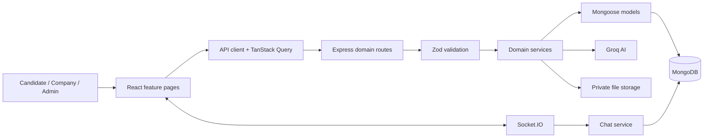

# Kế hoạch hoàn thiện chức năng và tối ưu trải nghiệm RabbitCV

> Ngày cập nhật: 07/08/2026  
> Phạm vi: toàn bộ workspace hiện tại, bao gồm cả thay đổi chưa commit  
> Trọng tâm mới: chức năng hoàn chỉnh, thao tác mượt, dữ liệu nhất quán, giao diện dễ dùng và code dễ phát triển tiếp  
> Bảo mật: chỉ giữ một mức nền tảng cần thiết, không phải mục tiêu chính của roadmap

## Trạng thái triển khai

**Đợt 1 đã hoàn thành ngày 07/08/2026:**

- Chuẩn hóa toast, hộp thoại xác nhận, select/menu, xử lý lỗi toàn ứng dụng và các hàm ngày giờ dùng chung.
- Đưa thông báo và danh sách việc làm đã lưu sang TanStack Query với cache, polling và optimistic update.
- Đưa đăng nhập/đăng ký sang React Hook Form + Zod; giữ nguyên tài khoản test `admin/1111`.
- Thay HTML nguy hiểm trong CV bằng pipeline Tiptap JSON/static renderer, dùng chung luồng in CV với `react-to-print` và nén ảnh chat bằng `compressorjs`.
- Loại bỏ dữ liệu admin giả và các trang admin không có API thật; bổ sung trạng thái lỗi/thử lại cho danh sách việc làm admin.
- Chuyển tác vụ hết hạn việc làm sang endpoint cron chạy được trên Vercel, loại `node-cron` khỏi runtime serverless.
- Tách các bundle lớn theo nhóm chức năng; build production không còn cảnh báo chunk vượt 500 kB.
- Kiểm tra giao diện desktop/mobile cho CV, hộp xác nhận và select; thanh công cụ CV mobile không còn tràn ngang.

**Các đợt tiếp theo vẫn giữ trong roadmap:** tách nhỏ CV editor và dashboard, chuẩn hóa nốt các lời gọi API bằng query/mutation, chuyển các form hồ sơ/tin tuyển dụng sang schema form, hoàn thiện retry/cursor cho chat, hoàn thiện toàn bộ trạng thái rỗng/lỗi và mở rộng kiểm thử luồng người dùng.

## 1. Mục tiêu sản phẩm

RabbitCV đã có gần đủ các nhóm chức năng của một nền tảng tuyển dụng cá nhân: tạo CV, AI hỗ trợ CV, tìm việc, ứng tuyển, quản lý hồ sơ, dashboard doanh nghiệp, admin, chat, thông báo, tin tức và phỏng vấn AI. Vấn đề lớn hiện tại không phải thiếu thật nhiều tính năng mới, mà là một số tính năng chưa đi hết luồng, dữ liệu còn đến từ nhiều nguồn, trang lớn khó bảo trì và trạng thái loading/error/saving chưa đồng nhất.

Kế hoạch mới ưu tiên theo thứ tự:

1. Mọi chức năng đang xuất hiện trên giao diện phải hoạt động thật từ đầu đến cuối.
2. Các thao tác chính phải có phản hồi rõ ràng: đang tải, đang lưu, thành công, lỗi, rỗng và thử lại.
3. Dữ liệu chỉ có một nguồn đáng tin cậy, không trộn API thật với dữ liệu mẫu trong runtime.
4. CV editor, chat và AI interview phải mượt trên cả desktop lẫn mobile.
5. Dùng thư viện ngoài ở những bài toán đã có giải pháp tốt, nhưng không thêm package chỉ để thay vài dòng code đơn giản.
6. Tách code theo chức năng để có thể sửa từng phần mà không làm ảnh hưởng toàn trang.
7. Giữ một nhóm bảo vệ tối thiểu để website không gặp sự cố nghiêm trọng khi deploy.

Không đề xuất viết lại toàn bộ hoặc đổi framework. Tiếp tục dùng React, Vite, Tailwind CSS, Express, Mongoose, Socket.IO và Tiptap.

## 2. Baseline hiện tại

| Hạng mục | Kết quả |
|---|---:|
| Tệp JS/JSX trong `src` và `server` | 109 |
| Tổng số dòng JS/JSX | 27.518 |
| Express endpoint trong `server/server.js` | 52 |
| Test hiện có | 41, tất cả đậu |
| ESLint | 0 lỗi, 2 cảnh báo hook dependency |
| Build Vite | Thành công |
| Chỗ dùng `dangerouslySetInnerHTML` | 36 |
| Lệnh `fetch` rải trong frontend | 73 |

Các tệp cần được chia nhỏ vì đang chứa quá nhiều trách nhiệm:

| Tệp | Số dòng | Nên tách theo |
|---|---:|---|
| `src/Components/ResumeForm.jsx` | 2.453 | Section CV, AI assistant, dialog, field component |
| `server/server.js` | 2.202 | Auth, user, resume, job, application, chat, admin, socket |
| `src/Components/ResumePreview.jsx` | 1.588 | Template và renderer dùng chung |
| `src/Pages/AiInterview.jsx` | 1.075 | Setup, session, conversation, feedback, result |
| `src/Pages/CompanyDashboard.jsx` | 1.072 | Job manager, application pipeline, company profile |
| `src/Pages/Resume.jsx` | 1.052 | Editor state, save orchestration, layout, preview |

Kết quả build đáng chú ý:

- Route `Resume` khoảng 627,52 kB trước gzip và đang vượt cảnh báo chunk 500 kB.
- `index` khoảng 452,11 kB, `ViewResume` khoảng 429,91 kB.
- PDF worker khoảng 1,23 MB, nên chỉ tải khi người dùng thực sự mở PDF.

## 3. Bản đồ chức năng và trạng thái

| Nhóm chức năng | Trạng thái | Vấn đề chính cần xử lý |
|---|---|---|
| Đăng ký, đăng nhập, phân vai | Có thể dùng | Guard route còn gom chung; trạng thái doanh nghiệp pending/banned chưa đồng nhất giữa UI và API |
| Trang chủ, menu, điều hướng | Có thể dùng | Route viết hoa/thường không nhất quán; fallback route luôn đưa về `/`; loading toàn trang còn đơn giản |
| Danh sách việc làm | Có thể dùng một phần | Đang trộn job từ MongoDB với `jobsData.js`, khiến filter, detail và saved job có thể không cùng nguồn |
| Chi tiết việc làm | Có thể dùng | Recommended jobs tải lại toàn bộ danh sách; các trạng thái hết hạn/ẩn/draft cần hiển thị nhất quán |
| Việc đã lưu | Có thể dùng | Mỗi card có thể gọi API riêng; loading/error còn phân tán |
| Ứng tuyển bằng CV | Có thể dùng | Cần luồng chọn CV, xác nhận, duplicate và kết quả rõ hơn |
| Ứng tuyển bằng PDF | Có thể dùng | Base64 làm request lớn; chưa có progress; preview/upload cần mượt hơn |
| CV library | Có thể dùng | Đổi tên, xóa, chọn mẫu và mở editor cần cùng một mutation/cache contract |
| CV editor | Nhiều chức năng | State quá lớn; chưa có autosave/dirty state hoàn chỉnh; AI và dialog chen nhiều logic vào form |
| CV preview/PDF | Có thể dùng | Sáu template lặp markup; chunk lớn; rich text render không qua một renderer chung |
| AI viết tiểu sử | Có thể dùng | Cần preview thay đổi, undo và lỗi/retry nhất quán |
| AI điền CV | Có thể dùng | Cần cho người dùng chọn mục nào được điền, chỉ điền phần thiếu và xem trước trước khi áp dụng |
| AI review toàn bộ CV | Có thể dùng | Cần liên kết từng gợi ý với đúng section và cho áp dụng/chỉnh sửa từng ý |
| Chấm điểm CV theo job | Có thể dùng | Cần history hoặc ít nhất giữ kết quả trong phiên và giải thích tiêu chí rõ ràng |
| Phỏng vấn AI | Có thể dùng | Trang lớn; cần giữ phiên, retry câu lỗi, composer mượt và xem đánh giá từng câu rõ hơn |
| Hồ sơ cá nhân/công khai | Có thể dùng | Form dài, trạng thái lưu chưa thống nhất; dữ liệu profile và CV chưa đồng bộ thành một luồng rõ ràng |
| Dashboard ứng viên | Có thể dùng | Dữ liệu application bị lặp với trang My Applications; nên dùng chung query/component |
| Dashboard doanh nghiệp | Nhiều chức năng | Một component chứa job form, danh sách job, ứng viên và profile; cần pipeline rõ hơn |
| Admin users/jobs/companies | Có thể dùng | Tải nhiều dữ liệu một lần; table chưa có server pagination chuẩn |
| Admin reports/logs/CV reviews | Chưa hoàn chỉnh | Frontend gọi endpoint không tồn tại hoặc dùng mock fallback; có trang đã không còn route |
| Chat | Có thể dùng | Cần trạng thái đang gửi/gửi lỗi, cursor, reconnect backfill và layout mobile tốt hơn |
| Thông báo | Có thể dùng | Polling, badge và danh sách nên dùng chung cache; thao tác mark read cần optimistic update |
| Tin tức | Có thể dùng | Dữ liệu tĩnh phù hợp đồ án nhưng ảnh ngoài và nội dung lớn làm bundle tăng |
| Accessibility/settings | Có thể dùng | Cần kiểm tra lại keyboard, responsive và tính nhất quán với layout chung |

## 4. Thứ tự ưu tiên mới

### P0: Chức năng đang hiển thị phải hoạt động thật

1. Không để trang admin gọi API không tồn tại rồi hiển thị mock như dữ liệu thật.
2. Việc làm chỉ lấy từ một nguồn runtime, ưu tiên MongoDB/API.
3. Phân vai và điều hướng phải đưa employee, company và admin đúng dashboard ở mọi URL.
4. CV phải lưu ổn định, báo trùng tên rõ, không mất dữ liệu khi AI hoặc dialog gặp lỗi.
5. Mọi trang chính phải có loading, empty, error và retry state.
6. Không được mất tin nhắn hoặc câu trả lời AI khi request lỗi/reconnect.

### P1: Làm các luồng chính mượt và nhất quán

1. Một API client và một cơ chế server-state chung.
2. CV editor có autosave, dirty state, undo khi áp dụng AI và preview ổn định.
3. Job search/filter/sort có URL state, pagination và không gọi API lặp.
4. Application có timeline trạng thái rõ cho ứng viên và pipeline rõ cho doanh nghiệp.
5. Chat có optimistic message, retry, cursor và draft theo conversation.
6. AI interview lưu phiên, đánh giá từng câu và có thể tiếp tục sau refresh trong cùng phiên.

### P2: Chia nhỏ code, tối ưu hiệu năng và responsive

1. Chia các component trên 1.000 dòng theo feature.
2. Lazy-load Tiptap, PDF.js, AI dialogs và template ít dùng.
3. Chuẩn hóa dialog/select/dropdown và design tokens.
4. Tối ưu mobile cho Resume, Company Dashboard, Chat và AI Interview.
5. Thêm test hành vi và E2E cho các luồng quan trọng.

### P3: Mở rộng sau khi nền tảng ổn định

1. Lịch sử phiên phỏng vấn AI và so sánh tiến bộ.
2. Analytics cho application/job/CV nếu thực sự cần.
3. Virtualization cho danh sách rất dài sau khi đo hiệu năng.
4. Realtime fan-out nhiều instance bằng Redis khi lượng dùng đủ lớn.
5. CMS cho tin tức nếu nội dung cần cập nhật thường xuyên.

## 5. Kế hoạch chi tiết theo chức năng

### 5.1. Điều hướng, layout và trạng thái toàn cục

Mục tiêu: mọi trang có cách tải, báo lỗi và điều hướng giống nhau.

- Chuẩn hóa route về chữ thường: `/jobs`, `/resume`, `/dashboard`, `/company`, `/admin`.
- Giữ redirect từ URL cũ trong một thời gian để bookmark không hỏng.
- Tách guard thành `PublicOnlyRoute`, `AuthenticatedRoute`, `EmployeeRoute`, `CompanyRoute`, `AdminRoute`.
- Dùng layout riêng cho candidate, company và admin thay vì bọc thủ công từng trang.
- Tạo trang 403, 404 và error fallback thật thay vì luôn chuyển về trang chủ.
- Tạo `PageLoader`, skeleton, empty state, inline error và retry button dùng chung.
- Dùng `sonner` cho success/error/info/loading/promise toast; xóa provider, timer và Toast component tự viết.
- Dùng Error Boundary ở app, Resume editor và AI Interview.
- Giữ vị trí scroll hợp lý khi quay lại danh sách job hoặc trang ứng tuyển.
- Không để component header tự gọi `/api/me`; dữ liệu user chỉ đến từ Auth provider/query.

Tiêu chí hoàn thành:

- Mở bất kỳ URL nào cũng vào đúng layout theo role.
- Không có màn hình trắng khi lazy import hoặc request thất bại.
- Tất cả trang danh sách có đủ loading/empty/error/retry.

### 5.2. CV library và CV editor

Đây là chức năng cốt lõi nên được ưu tiên cao nhất.

#### Luồng CV library

- Danh sách CV dùng một query cache duy nhất.
- Tạo, đổi tên, xóa, nhân bản và cập nhật CV dùng mutation rồi invalidate đúng query.
- Khi trùng tên, dialog đặt giữa màn hình, giải thích rõ và focus vào ô tên để đổi.
- Không tự ghi đè CV khác chỉ vì trùng tên.
- Hiển thị mẫu đang dùng, ngày cập nhật và trạng thái draft/saved.
- Sau khi xóa, cho undo trong thời gian ngắn hoặc yêu cầu xác nhận rõ ràng.

#### State của editor

- Dùng React Hook Form với `FormProvider`, `useFieldArray`, `Controller` và `useWatch`; không giữ hàng chục `useState` và setter riêng cho từng section.
- `useFieldArray` quản lý profile, experience, education, skill, language, certificate, project, award và hobby; dùng `move`, `append`, `update`, `remove` thay các đoạn `map/filter/spread` lặp lại.
- Dùng `formState.isDirty`, `reset` và `setValue` cho dirty state, load CV và apply AI. Chỉ giữ state React riêng cho dialog, panel, request AI và trạng thái lưu.
- Định nghĩa một `ResumeDocument` thống nhất cho editor, API, preview và AI.
- Mỗi item có ID ổn định; không dùng index làm key.
- Có trạng thái `saved`, `saving`, `dirty`, `saveError` hiển thị cạnh nút lưu.
- Autosave debounce khoảng 800-1.200 ms sau thay đổi hợp lệ; nút Lưu vẫn được giữ.
- Chặn rời trang hoặc đổi CV khi có thay đổi chưa lưu.
- Khi save lỗi, dữ liệu trên màn hình vẫn còn và có nút thử lại.
- Selected template phải được lưu cùng CV.

#### Section và rich text

- Tách section: personal info, bio, profile, experience, education, skill, language, certificate, project, award, hobby.
- Tạo component dùng chung cho section header, add/remove/reorder, date range và rich text field.
- Giữ Tiptap làm editor; chuyển dần dữ liệu chuẩn sang Tiptap JSON để editor và preview render giống nhau.
- Sau khi dữ liệu chuyển sang Tiptap JSON, dùng `@tiptap/static-renderer/pm/react` trong một `RichTextContent` dùng chung thay vì 36 chỗ `dangerouslySetInnerHTML`.
- Cho kéo thả item và section bằng `dnd-kit` nếu người dùng cần sắp xếp.
- Sau kéo thả phải giữ focus, không làm layout nhảy và có nút lên/xuống thay thế cho keyboard/mobile.

#### AI trong editor

- AI viết tiểu sử luôn mở preview trước khi áp dụng.
- Nút Cải thiện chỉ cải thiện nội dung hiện tại, không hiển thị lời khuyên thay cho nội dung CV.
- AI điền CV hiển thị danh sách section sẽ được điền bằng checkbox.
- Mặc định chỉ chọn field đang thiếu; dữ liệu thật của profile/CV không bị ghi đè.
- Các nội dung AI tự tạo phải được đánh dấu để người dùng xem lại.
- AI review toàn bộ CV liên kết mỗi vấn đề với section tương ứng.
- Cho mở section, sửa thủ công hoặc áp dụng riêng từng đề xuất.
- Sau mỗi lần áp dụng AI có nút Hoàn tác.
- Nếu AI lỗi, dialog giữ nguyên dữ liệu và cho retry, không đóng đột ngột.

#### Preview và PDF

- Chỉ render template đang chọn; thumbnail dùng dữ liệu/raster nhẹ hơn.
- Tách sáu template thành các module lazy hoặc một renderer cấu hình dùng chung.
- Giữ kích thước A4 và CSS print hiện có.
- Dùng `react-to-print` quản lý content ref, tên file, `onBeforePrint`, `onAfterPrint` và lỗi in; không tự gắn listener/timer quanh `window.print` ở ba trang.
- Có zoom fit-width, fit-page và mức phần trăm ổn định.
- Preview không render lại toàn bộ khi chỉ thay đổi UI ngoài CV.
- PDF.js chỉ được tải tại trang xem PDF upload.

Tiêu chí hoàn thành:

- Có thể tạo, autosave, reload và tiếp tục CV mà không mất thay đổi.
- AI không ghi đè dữ liệu có sẵn nếu chưa được người dùng chọn.
- Editor, preview, view resume và PDF hiển thị rich text nhất quán.
- Route Resume không còn chunk trên 500 kB trước gzip.

### 5.3. Việc làm và tìm kiếm

- Bỏ việc ghép `dbJobs` với `src/data/jobsData.js` trong runtime.
- Chuyển job mẫu cần giữ thành script seed development idempotent.
- API `/api/jobs` hỗ trợ `q`, location, type, workModel, experience, salary, sort và pagination.
- Đồng bộ filter vào query string để refresh/back/share URL không mất trạng thái.
- Debounce ô tìm kiếm khoảng 250-350 ms và hủy request cũ bằng AbortSignal.
- Giữ dữ liệu trang trước khi tải trang mới để tránh giao diện nhấp nháy.
- Job card có chiều cao ổn định; skeleton cùng kích thước card thật.
- Saved job dùng optimistic update và rollback khi API lỗi.
- Job detail lấy related jobs bằng query riêng có limit, không tải toàn bộ jobs.
- Job hết hạn/đã đóng/đã xóa hiển thị một trạng thái thống nhất ở list, detail và saved jobs.
- Không hiện nút ứng tuyển khi trạng thái job không cho phép.
- Các filter desktop và mobile dùng cùng state/schema.

Tiêu chí hoàn thành:

- Cùng một job luôn có nội dung/trạng thái giống nhau trên mọi trang.
- Refresh hoặc back browser không làm mất filter và vị trí hợp lý.
- Không còn request N+1 khi mở Saved Jobs hoặc related jobs.

### 5.4. Ứng tuyển và dashboard ứng viên

- Gộp logic application dùng chung giữa User Dashboard và My Applications.
- Luồng ứng tuyển gồm ba bước rõ: chọn nguồn CV, kiểm tra thông tin, xác nhận gửi.
- Nếu chọn CV RabbitCV, hiển thị tên/mẫu/ngày cập nhật và link xem trước.
- Nếu upload PDF, hiển thị tên, dung lượng, tiến độ, preview và lỗi ngay tại field.
- Disable double-submit và xử lý duplicate application bằng trạng thái thân thiện.
- Sau khi gửi thành công, cập nhật ngay job detail, dashboard và lịch sử bằng query invalidation.
- Timeline ứng tuyển dùng cùng mapping trạng thái ở candidate và company.
- Cho candidate xem job snapshot ngay cả khi job đã xóa.
- Cover letter hiện tại là text thường, giữ đơn giản như yêu cầu, không thêm AI viết thư.
- Có trang chi tiết application hoặc panel thống nhất thay vì rải thông tin ở nhiều card.

Tiêu chí hoàn thành:

- Không thể gửi trùng do double-click.
- Sau khi apply, mọi màn hình liên quan cập nhật mà không cần reload.
- Ứng viên luôn biết hồ sơ đang ở bước nào và lần cập nhật gần nhất.

### 5.5. Dashboard doanh nghiệp

- Tách `CompanyDashboard.jsx` thành `CompanyOverview`, `JobList`, `JobEditor`, `ApplicationPipeline`, `CompanyProfile`.
- Route/tab nằm trong URL để refresh không quay về tab đầu.
- Dùng React Hook Form + Zod cho job và profile form.
- Job editor có draft, active, expired/closed rõ ràng; không dùng nhiều string mapping khác nhau.
- Form ngày hết hạn dùng validation chung và thông báo ngay tại field.
- Application pipeline có cột hoặc filter theo Pending, Reviewing, Interview, Offered, Accepted, Rejected.
- Khi đổi trạng thái ứng viên, dùng optimistic update và rollback khi lỗi.
- Xem CV/profile ứng viên trong luồng application, không mở dữ liệu rời khỏi ngữ cảnh.
- Dashboard overview lấy aggregate gọn từ API, không tải toàn bộ document chỉ để đếm.
- Profile doanh nghiệp lưu riêng và cập nhật tên hiển thị của job theo quy tắc rõ ràng.

Tiêu chí hoàn thành:

- Doanh nghiệp tạo/sửa/đóng job và xử lý application mà không reload trang.
- Form lỗi không làm mất dữ liệu đang nhập.
- Mỗi tab có URL và loading/error state riêng.

### 5.6. Admin

Các chức năng đang hoạt động nên được hoàn thiện trước khi thêm module admin mới.

- Dashboard stats chỉ trả số liệu aggregate và danh sách gần đây có limit.
- Users, jobs và companies dùng server-side pagination/filter/sort.
- Dùng TanStack Table cho table state nếu các bảng tiếp tục có nhiều thao tác.
- Ban/unban, verify/reject và hide/unhide có confirm dialog, loading theo row và rollback khi lỗi.
- Không tải toàn bộ users bên trong `/api/admin/stats`.

Xử lý các trang chưa hoàn chỉnh:

1. `AdminReviews.jsx`: hiện route đã redirect sang companies, nên xóa file/menu sau khi xác nhận không còn nhu cầu duyệt CV.
2. `AdminReports.jsx`: chỉ giữ nếu có chức năng người dùng gửi report end-to-end. Nếu làm, cần `Report` model, nút report ở job/profile, API create/list/resolve/dismiss. Nếu chưa làm trong đồ án, ẩn menu và xóa mock fallback.
3. `AdminSystemLogs.jsx`: không hiển thị log giả. Với đồ án cá nhân, có thể bỏ trang này; nếu giữ thì chỉ hiển thị audit action có cấu trúc.
4. Mọi trang admin không có backend phải bị ẩn khỏi navigation cho đến khi hoàn thành.

Tiêu chí hoàn thành:

- Không còn trang admin nào hiển thị mock sau khi API thất bại.
- Table không tải toàn bộ collection vào browser.
- Mọi thao tác row cho biết chính xác row nào đang xử lý.

### 5.7. Chat và thông báo

#### Chat

- Client gửi recipient/conversation ID, server quyết định conversation thực tế.
- Message API dùng cursor, mặc định tải các tin gần nhất rồi tải ngược khi scroll lên.
- Tin vừa gửi xuất hiện optimistic với trạng thái `sending`, `sent`, `failed`.
- Tin failed có nút retry; retry dùng clientMessageId để không tạo bản trùng.
- Reconnect Socket.IO phải gọi backfill từ message cuối đã biết.
- Draft lưu theo conversation; chuyển thread không mất nội dung đang gõ.
- Composer sticky, tự tăng chiều cao có giới hạn, Enter gửi và Shift+Enter xuống dòng.
- Ảnh có preview, progress, cancel và giới hạn dung lượng. Dùng `compressorjs` thay hàm `FileReader + Image + canvas` tự viết trong `ChatBox.jsx`.
- Thread list mobile mở dạng drawer; conversation chiếm đúng vùng còn lại.
- Nếu danh sách tin nhắn thực sự dài, dùng TanStack Virtual sau khi đo, không thêm ngay theo cảm tính.

#### Thông báo

- Dùng một query cache cho bell badge, dropdown và notifications page.
- Mark one/all read cập nhật optimistic, API lỗi thì rollback.
- Socket event thêm notification mới; polling giữ làm fallback với interval hợp lý.
- Dùng pagination/infinite query thay vì tải toàn bộ.
- Khi click notification, đánh dấu đã đọc rồi điều hướng đúng resource.

Tiêu chí hoàn thành:

- Mất mạng rồi kết nối lại không làm mất hoặc nhân đôi tin nhắn.
- Badge chat/thông báo giống nhau sau refresh.
- Composer và drawer hoạt động tốt trên màn hình nhỏ.

### 5.8. Phỏng vấn AI

- Tách trang thành `InterviewSetup`, `InterviewSession`, `QuestionProgress`, `Conversation`, `AnswerComposer`, `FeedbackPanel`, `InterviewResult`.
- Giữ ba độ dài 5, 8 và 12 câu như thiết kế đã duyệt.
- Setup gọn, nhớ lựa chọn gần nhất trong phiên.
- Khi bắt đầu, tạo session ID cục bộ hoặc backend để tránh nhầm response giữa hai phiên.
- Disable double-send; request đang chạy có thể cancel hoặc timeout rõ ràng.
- Nếu một turn lỗi, giữ câu trả lời và cho gửi lại, không bắt nhập lại.
- Giữ conversation scroll đúng vị trí, tự cuộn chỉ khi người dùng đang ở gần cuối.
- Progress bên trái có thể chọn câu đã trả lời để xem lại feedback.
- Feedback bên phải đổi theo câu được chọn, không chỉ luôn hiển thị câu mới nhất.
- Composer luôn nằm dưới conversation, không bị co/che ở desktop hoặc mobile.
- Kết thúc sớm phải có confirm dialog.
- Trang kết quả có tổng điểm, điểm tốt, điểm cần cải thiện và gợi ý luyện tiếp.
- Không hiển thị “còn bao nhiêu lượt AI” trên giao diện như yêu cầu trước đó.
- Có thể lưu session gần nhất để refresh không mất toàn bộ buổi phỏng vấn; lịch sử nhiều phiên là P3.

Tiêu chí hoàn thành:

- Không mất câu trả lời khi request AI thất bại.
- Có thể xem lại feedback của từng câu từ progress.
- Layout không có khoảng trống vô lý và composer luôn sử dụng được ở các viewport chính.

### 5.9. Hồ sơ cá nhân

- Chia form theo nhóm và dùng React Hook Form + Zod.
- Có profile completion từ dữ liệu thật, không tính từ field ảo.
- Save theo section hoặc một form có dirty state rõ ràng.
- Email/phone/company field dùng cùng schema ở frontend và backend.
- Nút “Dùng thông tin này cho CV” cho phép preview field nào sẽ được điền.
- AI Fill ưu tiên dữ liệu profile thật; phần thiếu mới được AI gợi ý.
- Public profile có layout candidate/company riêng và empty state cho section chưa có.
- Ảnh đại diện có crop/preview nếu chức năng ảnh tiếp tục được mở rộng; chỉ thêm `react-easy-crop` khi thực sự cần crop.

### 5.10. Tin tức và nội dung tĩnh

- Giữ dữ liệu tĩnh cho phạm vi đồ án, chưa cần CMS.
- Tách `newsArticles.js` khỏi initial bundle của các trang không dùng tin tức.
- Ảnh phải có width/height, lazy loading và fallback.
- Có thể đưa ảnh chính về local optimized WebP/AVIF để tránh phụ thuộc URL ngoài.
- Nếu sau này admin cần đăng bài, khi đó mới thiết kế Article model/CMS, không làm nửa chừng.

## 6. Kiến trúc đích phục vụ phát triển chức năng



Backend đề xuất:

```text
server/
  app.js
  index.js
  config/
  middlewares/
  modules/
    auth/
    users/
    resumes/
    jobs/
    applications/
    chat/
    notifications/
    admin/
    ai/
  socket/
  cron/
  shared/
```

Frontend đề xuất:

```text
src/
  app/
    router.jsx
    providers.jsx
  api/
    client.js
    query-client.js
  features/
    auth/
    resumes/
    jobs/
    applications/
    company/
    admin/
    chat/
    notifications/
    ai-interview/
  components/
    ui/
  utils/
```

Mỗi lần sửa một chức năng mới chuyển chức năng đó sang cấu trúc mới. Không làm một commit di chuyển toàn bộ dự án.

## 7. Thư viện ngoài nên sử dụng

### 7.1. Giữ thư viện hiện tại

| Thư viện | Dùng cho | Quyết định |
|---|---|---|
| Tiptap | Rich text CV | Giữ và chuẩn hóa JSON/renderer |
| React Router | Routing | Giữ, chuẩn hóa route/guard trước khi nghĩ đến major upgrade |
| Mongoose | Schema và database | Giữ, bổ sung validator/index |
| Socket.IO | Chat realtime | Giữ, bổ sung backfill/retry |
| Tailwind CSS | Styling | Giữ, thêm token/component wrapper |
| Heroicons | Icons | Giữ, không thêm bộ icon khác |
| OpenAI SDK với Groq base URL | AI request | Giữ, không cần thêm AI framework lúc này |

### 7.2. Nên thêm vì mang lại giá trị chức năng rõ ràng

| Thư viện | Dùng cho | Thời điểm | Lợi ích chính |
|---|---|---|---|
| [TanStack Query](https://tanstack.com/query/v5) | Jobs, CV list, applications, profile, chat threads, notifications, admin | Giai đoạn 1 | Bỏ fetch lặp, cache, loading/error, optimistic update, retry và invalidation thống nhất |
| [Zod](https://zod.dev/) | Form/API/env/AI output schema | Giai đoạn 1 | Frontend và backend dùng cùng quy tắc dữ liệu, lỗi field rõ ràng |
| [React Hook Form](https://react-hook-form.com/) + `@hookform/resolvers` | Login, register, profile, job form và toàn bộ CV editor | Giai đoạn 1-2 | `useFieldArray` thay state CRUD của các section CV; `isDirty/reset/setValue` thay dirty signature và nhiều setter thủ công |
| [Sonner](https://github.com/emilkowalski/sonner) | Toast toàn website | Giai đoạn 1 | Một `Toaster` và API `toast.*` thay Toast context, local toast state và timer tự viết |
| [Radix Primitives](https://www.radix-ui.com/primitives/docs/overview/introduction) | Dialog, AlertDialog, Select, Dropdown, Popover, Tooltip | Giai đoạn 1-2 | Focus, keyboard, portal và accessibility ổn định hơn custom modal |
| [date-fns](https://datefns.com/) | Format/parse/so sánh ngày, deadline và thời gian tương đối | Giai đoạn 1 | Thay các formatter và phép trừ millisecond lặp lại, gom quy tắc ngày về utility dùng chung |
| [sanitize-html](https://www.npmjs.com/package/sanitize-html) | Làm sạch rich text ở backend | Giai đoạn 1 | Thay sanitizer dùng regex tự viết bằng parser allowlist; chỉ dùng bản đã vá từ `2.17.4` trở lên |
| [`@dnd-kit/react`](https://dndkit.com/react/quickstart/) + `@dnd-kit/helpers` khi cần sortable | Sắp xếp item/section CV | Giai đoạn 2 | Kéo thả có sensor và keyboard support, không tự viết drag logic; dùng API React hiện hành thay cho package legacy |
| [`@tiptap/static-renderer`](https://tiptap.dev/docs/editor/api/utilities/static-renderer) | Render Tiptap JSON thành React element | Giai đoạn 2 | Một renderer dùng chung thay 36 chỗ `dangerouslySetInnerHTML`; HTML legacy chuyển sang JSON bằng `generateJSON` đã có trong `@tiptap/core` |
| [react-to-print](https://github.com/MatthewHerbst/react-to-print) | In/lưu CV qua print dialog | Giai đoạn 2 | Thay `document.title`, `afterprint`, timer và `window.print` tự quản lý ở Resume/ResumeSelection/ViewResume |
| [TanStack Table](https://tanstack.com/table/latest/docs/overview) | Bảng users/jobs/companies/applications | Giai đoạn 3 | Table state, sort/filter/selection nhất quán, vẫn giữ style Tailwind |
| `react-dropzone` | Khu vực upload PDF/image | Giai đoạn 2-3 | Drag/drop, input state và lỗi file dễ dùng hơn; backend vẫn phải validate |
| [Compressor.js](https://github.com/fengyuanchen/compressorjs) | Nén ảnh chat/avatar trước upload | Giai đoạn 2-4 | Thay `FileReader + Image + canvas.toDataURL` tự viết bằng một lời gọi nén bất đồng bộ |
| `react-error-boundary` | Error fallback theo feature | Giai đoạn 1 | Reset/retry feature lỗi mà không làm trắng toàn app |
| [Pino](https://getpino.io/) + `pino-http` | Log request/error | Giai đoạn 1 | Debug lỗi local/Vercel dễ hơn, ít ảnh hưởng UI nhưng tăng khả năng vận hành |

### 7.3. Chỉ thêm khi có số liệu chứng minh cần thiết

| Thư viện | Khi nào dùng |
|---|---|
| `@tanstack/react-virtual` | Chat/job/admin list đủ dài và profiling cho thấy DOM là bottleneck |
| Redis + Socket.IO Redis adapter | Production có nhiều instance và event realtime bị thiếu |
| Vercel Blob | Chuyển PDF/image khỏi Mongo base64 |
| `react-easy-crop` | Sản phẩm thực sự cần người dùng crop avatar/logo |
| CMS | Tin tức cần tạo/sửa thường xuyên bởi admin |

### 7.4. Thư viện phục vụ kiểm thử và bảo trì

| Thư viện | Vai trò |
|---|---|
| [Vitest](https://vitest.dev/guide/) | Unit/component test phù hợp Vite |
| [Testing Library](https://testing-library.com/docs/react-testing-library/intro/) + user-event | Test UI theo thao tác thật |
| [MSW](https://mswjs.io/) | Mock API nhất quán trong component test |
| [Supertest](https://github.com/ladjs/supertest) | Integration test Express |
| `mongodb-memory-server` | Database tạm cho integration test, chỉ dùng dev |
| [Playwright](https://playwright.dev/docs/intro) | E2E candidate/company/admin và screenshot responsive |
| [Knip](https://knip.dev/) | Tìm dead page, export và dependency không dùng |
| Prettier + `eslint-config-prettier` | Format nhất quán, chạy trong commit riêng |

### 7.5. Không cần thêm

| Thư viện | Lý do |
|---|---|
| Axios | Native fetch qua một `apiClient` là đủ |
| Redux/Zustand/`use-immer` | TanStack Query xử lý server-state; React Hook Form xử lý CV/form-state; state UI còn lại đủ nhỏ để dùng React hook |
| Formik | React Hook Form phù hợp hơn với kế hoạch |
| Editor khác | Tiptap đã đáp ứng tốt |
| html2canvas/jsPDF/html2pdf | Dễ làm sai A4 và page break; giữ CSS print |
| `@tiptap/html` | Browser đã có `generateHTML/generateJSON` trong `@tiptap/core`; renderer React dùng `@tiptap/static-renderer`, tránh kéo thêm `happy-dom` peer dependency |
| `@radix-ui/react-toast` | Sonner là API toast cấp cao hơn và thay được cả queue/timer/provider với ít code hơn |
| `browser-image-compression` | Chỉ chọn một thư viện nén ảnh; Compressor.js đang được duy trì gần hơn và không cần worker tải từ CDN mặc định |
| `react-pdf` | `pdfjs-dist` hiện đã render PDF upload ổn; thêm wrapper không thay được CSS A4/print và không giảm đủ code |
| UI framework đầy đủ mới | Làm giao diện mất đồng nhất; dùng Radix primitive từng phần |
| Framer Motion chỉ để trang “mượt hơn” | CSS transition đủ cho phần lớn tương tác; không thêm bundle nếu không có animation phức tạp |
| Moment.js/Day.js | Chọn duy nhất `date-fns` để tránh hai thư viện ngày cùng tồn tại |

### 7.6. Nguyên tắc thêm package để dự án không bị nặng

1. Chỉ cài package chính chủ, còn được bảo trì và license phù hợp.
2. Cài từng nhóm nhỏ trong pull request riêng.
3. Commit lockfile và deploy bằng `npm ci`.
4. Chạy audit, test và đo bundle trước/sau khi thêm.
5. Không tải JS runtime từ CDN nếu có thể bundle local.
6. Không thêm hai thư viện giải quyết cùng một vấn đề.
7. Package optional phải có tiêu chí kích hoạt, không cài sẵn “để đó”.
8. Chốt một Node major được Vercel hỗ trợ và ghi vào `engines`; package mới hiện yêu cầu tối thiểu Node 22 ở một số phiên bản.
9. Tất cả package Tiptap, gồm `core`, `pm`, `react`, `starter-kit` và `static-renderer`, phải dùng cùng phiên bản chính xác vì peer dependency của Tiptap khớp theo version.
10. Không tự động cài “latest”: kiểm tra React 18 peer dependency, Node engine, license, audit và build trước khi ghi lockfile.

### 7.7. Danh sách package sẽ xóa, chuyển nhóm và thêm mới

Danh sách này được đối chiếu với import thực tế trong source. Việc xóa package chỉ thực hiện sau khi sửa code thay thế và chạy lại `npm run check`; không xóa hàng loạt chỉ dựa vào tên package.

#### A. Xóa khỏi dependency hiện tại

| Package/tài nguyên | Khi xóa | Chức năng thay thế hoặc lý do |
|---|---|---|
| `@tiptap/extension-highlight` | Có thể xóa ngay sau build/test | Editor hiện không import hoặc cấu hình highlight; không có chức năng người dùng nào bị mất. |
| `@tiptap/extension-text-align` | Có thể xóa ngay sau build/test | Editor hiện không có lệnh căn trái/giữa/phải; không cần package chưa dùng. Nếu sau này thêm căn lề thì cài lại đúng lúc. |
| `@tiptap/extension-text-style` | Có thể xóa ngay sau build/test | Chưa có màu chữ/font/inline style dựa trên extension này; không cần chức năng thay thế. |
| Khai báo trực tiếp `@tiptap/extension-link` | Có thể xóa khỏi `package.json` sau test editor | Tiptap `StarterKit` v3 đã kéo và kích hoạt Link. Chức năng link vẫn do `@tiptap/starter-kit` cung cấp. |
| Khai báo trực tiếp `@tiptap/extension-underline` | Có thể xóa khỏi `package.json` sau test editor | Tiptap `StarterKit` v3 đã kéo và kích hoạt Underline. Chức năng gạch chân vẫn còn qua `@tiptap/starter-kit`. |
| Flowbite CSS/JS CDN trong `index.html` | Xóa ở Giai đoạn 1 | Source không dùng component/attribute Flowbite. Styling giữ bằng Tailwind; dialog/select/dropdown tương tác chuyển sang Radix. Việc xóa cũng bỏ một CSS/JS tải ngoài không cần thiết. |
| `node-cron` | Chỉ xóa sau khi endpoint cron mới chạy được ở local và Vercel | Chuyển `runJobExpiryCheck` thành một service được gọi bởi HTTP cron endpoint; Vercel Cron gọi endpoint ở production, local gọi bằng script hoặc endpoint test. Chức năng báo job sắp hết hạn/hết hạn vẫn giữ nguyên. |

Không xóa `@tiptap/core`, `@tiptap/pm`, `@tiptap/react`, `@tiptap/starter-kit`, `@tiptap/extension-bubble-menu` hoặc `@tiptap/extension-floating-menu`. `core` và `pm` là peer dependency bắt buộc của React adapter; module `@tiptap/react/menus` hiện import cả Bubble Menu và Floating Menu nên hai menu package vẫn cần để bundler resolve ổn định.

Các package xuất hiện trong `node_modules` nhưng không có trong `package.json` chỉ được dọn bằng `npm prune`; đây là dọn thư mục cài đặt, không phải thay đổi chức năng của dự án.

#### B. Chuyển từ `dependencies` sang `devDependencies`, không xóa

| Package | Vì sao chuyển nhóm | Chức năng vẫn giữ |
|---|---|---|
| `@tailwindcss/vite` | Chỉ chạy khi Vite build CSS | Tailwind Vite plugin vẫn hoạt động khi dev/build. |
| `tailwindcss` | Công cụ build giao diện, không được import ở Node runtime | Toàn bộ utility class và CSS hiện tại vẫn giữ. |
| `sass-embedded` | Chỉ biên dịch `src/Components/RichText/styles.scss` lúc dev/build | Style của Tiptap vẫn được biên dịch như hiện tại. |
| `mongodb` | Hiện chỉ được import bởi `scripts/migrate-mongo.js` | Script migrate local/remote Mongo vẫn chạy; backend runtime tiếp tục dùng Mongoose. |

#### C. Package sẽ thêm trong roadmap chính

| Package | Mục đích | Thay thế phần code/chức năng tự viết |
|---|---|---|
| `@tanstack/react-query` | Cache và đồng bộ jobs, CV, applications, profile, chat, notification, admin | Thay các cụm `useEffect + fetch + loading/error + refetch` lặp lại; không thay `fetch` hay API backend. |
| `zod` | Schema dùng chung cho form, API payload, env và structured output AI | Thay validation thủ công rải ở từng form/route; không thay Mongoose model. |
| `react-hook-form` + `@hookform/resolvers` | Quản lý login, register, profile, job form và CV editor | `useFieldArray` thay CRUD thủ công của chín mảng CV; `formState.isDirty/reset/setValue` thay chữ ký JSON và nhiều setter. Tiptap nối qua `Controller`. |
| `sonner` | Toast success/error/info/loading cho toàn app | Thay `src/Components/Toast.jsx`, `ToastProvider`, `useToast`, local toast state và `setTimeout` ở Resume. |
| `@radix-ui/react-dialog`, `@radix-ui/react-alert-dialog` | Modal nhập liệu và xác nhận | Thay portal/focus trap/Escape/overlay tự viết trong popup và confirm dialog. |
| `@radix-ui/react-select`, `@radix-ui/react-dropdown-menu`, `@radix-ui/react-popover`, `@radix-ui/react-tooltip` | Các control nổi có keyboard/focus chuẩn | Thay select/dropdown/popover/tooltip tự quản lý vị trí, đóng mở và focus. Chỉ cài package nào được dùng thật. |
| `date-fns` | Xử lý ngày CV, deadline job, notification và thời gian tương đối | Thay phép trừ millisecond, `toLocaleDateString` và `Intl.DateTimeFormat` rải rác bằng utility thống nhất có locale `vi`. Phần nhận biết chữ “Hiện tại” vẫn là quy tắc nghiệp vụ riêng. |
| `sanitize-html` | Sanitize rich text tại API boundary | Thay toàn bộ regex trong `server/utils/richTextSanitizer.js` bằng allowlist parser. Dùng bản `>=2.17.4`, khóa tag/attribute đúng schema Tiptap và giữ test payload lỗi hiện có. |
| `@dnd-kit/react` + `@dnd-kit/helpers` | Kéo thả sắp xếp item và section CV | Thay drag/sort logic thủ công; vẫn giữ nút di chuyển bằng bàn phím làm phương án dự phòng. |
| `@tiptap/static-renderer` | Render Tiptap JSON trực tiếp thành React element | Thay 36 chỗ `dangerouslySetInnerHTML` trong form/preview bằng một `RichTextContent`; dùng cùng extension với editor. Không thêm `@tiptap/html`. |
| `react-to-print` | Quản lý nội dung và lifecycle in CV | Thay ba nhánh `window.print`, đổi `document.title`, timer và listener `afterprint`; CSS A4 vẫn được giữ. |
| `@tanstack/react-table` | Sort, filter, pagination, selection cho bảng admin/company | Thay table state và handler lặp ở users/jobs/companies/applications; API pagination vẫn do backend xử lý. |
| `react-dropzone` | Upload PDF, avatar và logo bằng chọn file hoặc kéo thả | Thay phần quản lý drag event, input file và trạng thái lỗi file ở frontend; backend vẫn kiểm tra loại/dung lượng. |
| `compressorjs` | Nén/resize ảnh trước khi gửi chat hoặc upload avatar/logo | Thay hàm `compressImage` khoảng 40 dòng trong `ChatBox.jsx`; kết quả Blob/File tiếp tục đi qua luồng upload hiện có. |
| `react-error-boundary` | Cô lập lỗi theo feature và cho phép thử lại | Thay fallback rời rạc hoặc màn hình trắng khi một component lỗi. |
| `pino` + `pino-http` | Log request, cron và lỗi backend có cấu trúc | Thay phần lớn `console.log/error` rải rác, giúp đọc log local/Vercel dễ hơn. |

#### D. Package dev/test sẽ thêm

| Package | Mục đích | Thay thế cách kiểm tra hiện tại |
|---|---|---|
| `vitest` | Unit test và component test chạy cùng Vite | Chuyển dần test frontend khỏi `node --test`; test Node phù hợp vẫn có thể giữ trong giai đoạn chuyển tiếp. |
| `@testing-library/react` + `@testing-library/user-event` + `@testing-library/jest-dom` | Test giao diện bằng hành vi người dùng | Thay test regex chỉ đọc source đối với các luồng tương tác. |
| `msw` | Mock API dùng chung cho component test | Thay mock `fetch` thủ công khác nhau giữa từng test. |
| `supertest` | Test route Express không cần mở cổng thật | Thay script gọi HTTP thủ công để kiểm tra API. |
| `mongodb-memory-server` | Mongo tạm biệt lập cho integration test | Thay việc phụ thuộc MongoDB Compass/database thật khi chạy test tự động. |
| `@playwright/test` | E2E candidate/company/admin và kiểm tra responsive | Thay phần lớn thao tác kiểm thử trình duyệt thủ công sau mỗi thay đổi lớn. |
| `knip` | Tìm file, export và dependency không còn dùng | Thay việc dò dead code/package hoàn toàn thủ công. |
| `prettier` + `eslint-config-prettier` | Format source nhất quán | Thay format thủ công; ESLint vẫn giữ nhiệm vụ tìm lỗi code. |

#### E. Chỉ thêm khi phát sinh nhu cầu thật

| Package/dịch vụ | Chỉ thêm khi | Thay thế hoặc mở rộng gì |
|---|---|---|
| `@tanstack/react-virtual` | Danh sách chat/job/admin dài gây chậm DOM | Thay việc render toàn bộ hàng cùng lúc bằng virtualized list. |
| `redis` + `@socket.io/redis-adapter` | Socket production chạy nhiều instance và bỏ sót event | Mở rộng Socket.IO qua nhiều instance; không thay Socket.IO. |
| `@vercel/blob` | PDF/avatar/logo làm Mongo phình vì base64 | Thay lưu binary/base64 trong document bằng URL object storage. |
| `react-easy-crop` | Có yêu cầu crop avatar/logo thật sự | Thay crop canvas/toạ độ tự viết. |
| Một CMS phù hợp | Admin cần tự tạo/sửa tin thường xuyên | Thay `src/data/newsArticles.js` tĩnh bằng dữ liệu quản trị được. |

Tóm lại, đợt đầu thêm Query, Zod, React Hook Form, Sonner, date-fns, sanitize-html, các Radix primitive thực sự cần và bộ test nền. Static Renderer, react-to-print, Compressor.js, dnd-kit, Table và Dropzone chỉ được cài trong commit có code chuyển đổi tương ứng để tránh package tồn tại mà không được dùng.

### 7.8. Những chức năng tự viết nên được thay bằng đúng một library

| Chức năng/source hiện tại | Library chọn | Sau khi chuyển đổi | Quyết định |
|---|---|---|---|
| `Toast.jsx`, hai API toast khác nhau, khoảng 98 lời gọi và timer riêng ở Resume | `sonner` | Một `<Toaster />`; gọi `toast.success/error/info` hoặc `toast.promise` trực tiếp | Thay toàn bộ, sau đó xóa `Toast.jsx` và `ToastProvider` |
| 55 lệnh `useState`, khoảng 253 setter call trong Resume/ResumeForm, chín mảng section và nhiều đoạn `map/filter/spread` | `react-hook-form` | `FormProvider`, `useFieldArray`, `Controller`, `useWatch`; AI dùng `setValue`, load/save dùng `reset` | Thay form-state; không thêm Redux/Zustand/use-immer |
| `SavedJobsContext`, `useNotifications`, polling và optimistic rollback tự viết | `@tanstack/react-query` | Query/mutation cache, `refetchInterval`, optimistic update và rollback theo query key | Thay server-state; chỉ giữ context cho socket/UI thật sự toàn cục |
| `ConfirmPopUp.jsx` và bảy `window.confirm` | `@radix-ui/react-alert-dialog` | Một `ConfirmDialog` dùng chung, hỗ trợ focus/Escape/loading theo action | Thay toàn bộ confirm tự viết |
| `SelectDropdown.jsx`, `StyledSelect.jsx`, `FilterDropdown.jsx` và listener click-outside | `@radix-ui/react-select` hoặc `@radix-ui/react-dropdown-menu` đúng loại control | Wrapper style RabbitCV dùng chung, keyboard/focus do Radix xử lý | Thay ba component tự viết sau khi migrate nơi sử dụng |
| Formatter ngày trùng lặp, tính deadline bằng `86400000`, relative time tự chia giây/phút/giờ | `date-fns` | Một `dateUtils` với locale `vi`, `format`, `formatDistanceToNow`, `differenceInCalendarDays`, `isBefore`, `isValid` | Thay phép tính/format chung; giữ parser nghiệp vụ “Hiện tại” |
| Regex sanitizer trong `server/utils/richTextSanitizer.js` | `sanitize-html` | Một cấu hình `allowedTags/allowedAttributes/allowedSchemes` và test | Thay toàn bộ parser regex; không dùng đồng thời DOMPurify |
| 36 chỗ `dangerouslySetInnerHTML` cho rich text CV | `@tiptap/static-renderer` | Một `RichTextContent` render Tiptap JSON thành React element | Thay sau migration JSON; HTML legacy chỉ là fallback tạm |
| `compressImage` dùng `FileReader`, `Image`, canvas và `toDataURL` trong ChatBox | `compressorjs` | Một Promise wrapper gọi Compressor với maxWidth/maxHeight/quality | Thay toàn bộ hàm nén tự viết; không thêm library nén ảnh thứ hai |
| Ba luồng `window.print`, đổi title, `afterprint` và timer | `react-to-print` | Một hook `useResumePrint` dùng content ref và `documentTitle` | Thay lifecycle tự viết; vẫn dùng CSS A4 của dự án |
| Vùng upload tự quản drag/input/error | `react-dropzone` | Một `FileDropzone` dùng chung cho PDF/avatar/logo | Thay interaction frontend; không thay validation API |
| Sort/filter/selection/pagination ở bảng admin/company | `@tanstack/react-table` | Column definition và table model dùng chung | Thay table-state, không thay HTML/Tailwind hay backend pagination |
| Log request/cron/error bằng `console.*` | `pino` + `pino-http` | Logger JSON có request ID và level | Thay log backend; frontend vẫn chỉ log lỗi development cần thiết |

Không thêm library cho các việc native đã đủ ngắn: dùng `crypto.randomUUID()` cho ID tạm, `AbortController` cho hủy request, `<a download>` cho tải file, CSS/`ResizeObserver` cho zoom CV và một hook debounce nhỏ nếu chỉ có một nơi dùng. Đây là các trường hợp thêm package sẽ làm dependency tree khó hiểu hơn code được tiết kiệm.

## 8. API và dữ liệu để trang hoạt động mượt

### 8.1. API client chung

Tạo `src/api/client.js` xử lý:

- Base URL tương đối `/api` cho cả local và Vercel.
- `credentials: include` mặc định.
- Parse JSON an toàn.
- Error object thống nhất gồm `code`, `message`, `fields`, `status`.
- AbortSignal/timeout.
- Không tự toast trong client; feature quyết định cách hiển thị lỗi.

TanStack Query xử lý cache và request lifecycle; không nhét server-state vào Context. Context chỉ giữ auth, socket và UI state thật sự toàn cục.

### 8.2. Response contract

```json
{
  "data": {},
  "meta": {
    "nextCursor": null,
    "total": 0
  }
}
```

```json
{
  "error": {
    "code": "VALIDATION_FAILED",
    "message": "Thông tin chưa hợp lệ",
    "fields": {}
  }
}
```

Không cần đổi tất cả endpoint cùng lúc. Chuyển theo feature: CV trước, jobs/applications sau, chat/admin cuối.

### 8.3. Pagination và index

Ưu tiên pagination cho:

- Jobs và saved jobs.
- Applications theo candidate/company/job/status.
- Chat messages và chat users.
- Notifications.
- Admin users/jobs/companies.

Index cần đối chiếu theo query thật:

| Model | Index chính |
|---|---|
| Resume | user + updatedAt; user + normalized title |
| Job | public status + expiry + createdAt; company + status + createdAt |
| Application | job + candidate unique; candidate + createdAt; job + status + createdAt |
| Message | conversation/room + createdAt |
| Notification | recipient + read state + createdAt |
| User | role/status; normalized username/email |

### 8.4. Dữ liệu rich text

- Tiptap JSON là nguồn chuẩn dài hạn.
- Trong giai đoạn chuyển đổi, đọc JSON trước và fallback HTML cũ.
- Backfill theo batch; preview snapshot từng template trước/sau.
- Không xóa HTML cũ ngay để có thể rollback.
- Khi migration hoàn tất, editor/preview/view/print cùng dùng một renderer.

### 8.5. PDF và image

Base64 trong Mongo vẫn chạy cho đồ án nhỏ nhưng ảnh hưởng tốc độ request và kích thước document. Lộ trình phù hợp:

1. Trước mắt lazy-load preview, giới hạn file và hiển thị trạng thái đọc tệp thật từ FileReader; chỉ hiển thị phần trăm upload khi có direct upload cung cấp progress thực.
2. Sau khi luồng ổn định, thêm private object storage.
3. Mongo chỉ giữ metadata và storage key.
4. Duy trì fallback đọc `pdfData` cho file cũ đến khi backfill xong.

## 9. Nguyên tắc làm trang mượt

### Request và dữ liệu

- Không gọi cùng endpoint từ Header, page và context cùng lúc.
- Dedupe và cache bằng TanStack Query.
- Hủy search request cũ.
- Optimistic update cho save job, mark read và application status.
- Giữ previous data khi phân trang/filter.
- Retry tự động chỉ cho lỗi mạng/5xx phù hợp, không retry 4xx.

### Rendering

- Lazy-load theo feature, không chỉ theo page.
- Không memo hóa mọi component; profile trước rồi tối ưu chỗ render tốn kém.
- Component lặp cần key ổn định.
- Không render cả sáu CV template đầy đủ khi chỉ xem một template.
- Virtualize chỉ khi danh sách dài thật.
- Tránh set state nối tiếp gây nhiều render trong AI Fill.

### Giao diện

- Skeleton có cùng kích thước nội dung thật để tránh layout shift.
- Button async giữ kích thước, chỉ đổi icon/text trạng thái.
- Modal render qua portal giữa viewport.
- Input lỗi không làm layout nhảy mạnh.
- Composer, toolbar và action chính luôn nằm trong vùng nhìn thấy.
- Animation ngắn 120-220 ms, tôn trọng `prefers-reduced-motion`.
- Desktop, tablet và mobile dùng breakpoint/layout được định nghĩa rõ, không sửa từng ảnh chụp bằng magic number.

### Mục tiêu đo được

- Không còn Vite chunk warning trên 500 kB cho route chính.
- Không có duplicate request khi mở một page.
- Search không phát request theo từng phím nếu chưa hết debounce.
- Sau thao tác mutation, UI cập nhật ngay hoặc có loading đúng vị trí, không reload toàn trang.
- Layout không nhảy khi skeleton chuyển sang dữ liệu thật.

## 10. Kế hoạch triển khai theo giai đoạn

### Giai đoạn 0: Làm sạch chức năng đang dang dở, 2-4 ngày

- [ ] Chốt menu/page nào thật sự thuộc scope đồ án.
- [ ] Ẩn hoặc xóa Admin Reports/System Logs/CV Reviews nếu chưa làm backend.
- [ ] Xóa mock fallback trên các trang production.
- [ ] Bỏ trộn static jobs và DB jobs; tạo seed development.
- [ ] Chuẩn hóa redirect employee/company/admin và URL cũ.
- [ ] Tạo loading/empty/error/retry component dùng chung.
- [ ] Sửa 2 ESLint warning hiện tại.
- [ ] Giữ `admin/1111` làm tài khoản test local/demo, chuẩn hóa nó thành seed có nhãn rõ ràng; xử lý JWT fallback, PDF.js và quyền sai role.

Kết quả: giao diện không còn nút/trang giả; mọi menu dẫn đến chức năng hoạt động thật hoặc được ẩn rõ ràng.

### Giai đoạn 1: API client, server-state và form, 4-6 ngày

- [ ] Thêm API client chung.
- [ ] Thêm TanStack Query và migrate Auth/CV list/jobs trước.
- [ ] Thêm Zod schema dùng chung cho auth, profile và job.
- [ ] Dùng React Hook Form cho login/register/profile/job; chuẩn bị Resume schema và component field dùng chung.
- [ ] Dùng Radix cho dialog/confirm/select quan trọng.
- [ ] Thay Toast tự viết bằng Sonner; thêm Error Boundary.
- [ ] Chuẩn hóa utility ngày bằng date-fns và thay rich-text regex bằng sanitize-html có test.
- [ ] Thêm pagination cho jobs/admin users/applications.
- [ ] Tách backend auth/user/job/resume route bước đầu.

Kết quả: fetch/loading/error/mutation nhất quán; form không mất dữ liệu khi lỗi.

### Giai đoạn 2: Hoàn thiện CV, 6-10 ngày

- [ ] Tạo ResumeDocument và chuyển Resume editor sang React Hook Form/FormProvider/useFieldArray.
- [ ] Tách ResumeForm theo section.
- [ ] Autosave dựa trên `useWatch`, dirty state dựa trên `formState.isDirty`, retry và chặn rời trang khi chưa lưu.
- [ ] Chuẩn hóa duplicate title/rename flow.
- [ ] Tích hợp dnd-kit cho reorder nếu giữ tính năng sắp xếp.
- [ ] Chuyển rich text sang Tiptap JSON theo dual-read bằng API có sẵn trong `@tiptap/core`.
- [ ] Thêm `@tiptap/static-renderer` cùng version Tiptap và tạo `RichTextContent` dùng chung cho preview/view/print.
- [ ] Thêm `react-to-print` và gom ba luồng in thành `useResumePrint`.
- [ ] Thiết kế lại AI Fill/Review theo preview, checkbox, apply riêng và undo.
- [ ] Lazy-load Tiptap, PDF.js, AI dialog và template.
- [ ] Test snapshot A4 và save/reload.

Kết quả: CV editor là một luồng hoàn chỉnh, mượt và không mất dữ liệu.

### Giai đoạn 3: Jobs, applications, company và admin, 5-8 ngày

- [ ] Server-side search/filter/sort/pagination cho jobs.
- [ ] URL state cho filter.
- [ ] Optimistic saved jobs.
- [ ] Luồng application ba bước và upload feedback.
- [ ] Timeline application dùng chung.
- [ ] Tách CompanyDashboard theo feature/tab.
- [ ] Application pipeline cho doanh nghiệp.
- [ ] TanStack Table cho admin nếu cần.
- [ ] Aggregate endpoint cho overview/statistics.
- [ ] Hoàn thiện hoặc gỡ hẳn admin module ngoài scope.

Kết quả: candidate và company hoàn thành trọn vẹn quy trình từ tìm việc đến xử lý hồ sơ.

### Giai đoạn 4: Chat, thông báo và AI Interview, 5-8 ngày

- [ ] Cursor message và conversation model/contract rõ ràng.
- [ ] Optimistic send, clientMessageId, retry và reconnect backfill.
- [ ] Thay hàm nén ảnh canvas trong ChatBox bằng Compressor.js.
- [ ] Draft theo conversation và composer mới.
- [ ] Đồng bộ badge/list notification qua một query cache.
- [ ] Socket notification với polling fallback.
- [ ] Tách AI Interview thành các component nhỏ.
- [ ] Retry turn, giữ answer, progress chọn câu và feedback đúng câu.
- [ ] Lưu session gần nhất trong phiên.
- [ ] Responsive test cho chat và interview.

Kết quả: chat và AI không mất nội dung khi mạng chậm hoặc request lỗi.

### Giai đoạn 5: Hiệu năng, test và polish, 4-7 ngày

- [ ] Phân tích bundle và network waterfall.
- [ ] Đưa chunk chính dưới budget.
- [ ] Tối ưu ảnh, font và news assets.
- [ ] Vitest/Testing Library cho component quan trọng.
- [ ] Supertest cho API chính.
- [ ] Playwright E2E candidate/company/admin.
- [ ] Accessibility và responsive sweep.
- [ ] Knip dọn dead page/dependency.
- [ ] Cập nhật README, sơ đồ và hướng dẫn chạy/deploy.

Kết quả: website có baseline kiểm thử và không quay lại các lỗi luồng đã sửa.

Tổng ước lượng: khoảng 26-43 ngày làm việc cho một người. Có thể deploy sau từng giai đoạn; không cần chờ hoàn tất toàn bộ.

## 11. Chiến lược kiểm thử tập trung vào chức năng

### Unit

- Normalize date, title và job status.
- Resume schema, field-array operations, AI merge/undo và autosave mapping.
- Filter/query param mapping.
- Application status mapping.
- AI result cleaning.

### Component

- Form validation và giữ dữ liệu khi submit lỗi.
- Query loading/empty/error/retry.
- Resume section add/edit/remove/reorder.
- AI preview/apply/cancel/undo.
- Dialog keyboard và focus.
- Chat sending/sent/failed/retry.

### API integration

- Save/update/duplicate/delete CV.
- Job filter/pagination/detail.
- Apply bằng CV và PDF, duplicate application.
- Company update application status.
- Chat cursor/read/hide/send.
- Notification pagination/read state.
- AI timeout/quota/provider error.

### E2E

1. Employee đăng nhập, tạo CV, AI cải thiện, lưu, reload và tải PDF.
2. Employee tìm/filter/save job rồi ứng tuyển.
3. Company đăng job, nhận application và đổi trạng thái.
4. Admin quản lý user/job/company trên dữ liệu thật.
5. Hai browser context gửi chat, mất mạng rồi reconnect.
6. AI Interview 5/8/12 câu, retry lỗi và xem feedback từng câu.
7. Mobile flow cho Resume, Chat, Job Detail và AI Interview.

Các test regex đọc source hiện có chỉ giữ cho quy tắc tĩnh. Luồng người dùng phải được test bằng component/API/E2E.

## 12. Bảo mật tối thiểu cần giữ

Đây không phải trọng tâm chính, nhưng các mục sau nhỏ và có ảnh hưởng trực tiếp đến việc website chạy ổn định:

1. Giữ nguyên tài khoản `admin/1111` để test local/demo và ghi rõ trong seed/README đây là dữ liệu thử nghiệm; không đưa việc xóa tài khoản này vào roadmap. JWT fallback cố định vẫn nên chuyển sang biến môi trường để các phiên đăng nhập ổn định giữa những lần deploy.
2. Cập nhật PDF.js và tắt scripting khi mở PDF upload.
3. Backend vẫn phải kiểm tra đúng role/owner cho CV, job, application và chat.
4. Không commit API key, cookie đăng nhập hoặc file env.
5. Không trả password/PIN/API key trong response/log.
6. Giữ Helmet, CORS allowlist và rate limit hiện có.
7. Validation file vẫn kiểm tra loại và dung lượng ở backend.
8. Dependency mới vẫn phải qua audit và lockfile.

Các việc như Redis rate limit phân tán, audit log nâng cao, secret history rewrite hay hardening CSP sâu chỉ nâng ưu tiên khi website có người dùng thật hoặc triển khai production rộng hơn.

## 13. Definition of Done

- [ ] Mọi mục trong navigation mở ra chức năng thật; không còn mock fallback giả thành công.
- [ ] Candidate hoàn thành được luồng tạo CV, tìm việc, lưu việc, ứng tuyển và xem trạng thái.
- [ ] Company hoàn thành được luồng tạo job, nhận hồ sơ và xử lý application.
- [ ] Admin users/jobs/companies dùng dữ liệu thật, pagination và trạng thái rõ ràng.
- [ ] CV có autosave/dirty/error/retry; AI có preview/apply/undo.
- [ ] Job chỉ dùng một nguồn runtime và filter nằm trong URL.
- [ ] Chat có optimistic state, retry và reconnect backfill.
- [ ] AI Interview không mất câu trả lời khi request lỗi và xem được feedback từng câu.
- [ ] Mọi trang chính có loading, empty, error và retry state.
- [ ] Không còn duplicate request dễ thấy khi mở một trang.
- [ ] Không còn route chunk chính vượt 500 kB trước gzip.
- [ ] Desktop/mobile không có overlap, vùng trống bất thường hoặc composer bị che.
- [ ] Test component/API/E2E bảo vệ các luồng chính.
- [ ] README và tài liệu khớp với chức năng thật trên website.
- [ ] Nhóm bảo mật tối thiểu ở mục 12 đã hoàn thành.

## 14. Sprint đầu tiên nên thực hiện

1. Kiểm kê navigation và ẩn/xóa các trang admin chưa có backend.
2. Bỏ mock fallback của AdminReports/AdminSystemLogs.
3. Chuyển jobs runtime về một nguồn API; tạo seed cho dữ liệu mẫu.
4. Chuẩn hóa route và redirect theo role.
5. Tạo Loading/Empty/Error/Retry dùng chung và thay Toast tự viết bằng Sonner.
6. Thêm API client và TanStack Query cho Auth, CV list và Jobs.
7. Sửa CV save state, duplicate name và selected template persistence.
8. Thêm autosave/dirty state cơ bản cho CV trước khi tách form lớn.
9. Sửa 2 ESLint warning và thêm integration test cho save CV/job list.
10. Chuẩn hóa seed tài khoản test `admin/1111`, cấu hình JWT, PDF.js, role API và file môi trường hiện tại mà không xóa tài khoản test.

Sau sprint này, website chưa cần có thêm tính năng mới nhưng sẽ đáng tin cậy và dễ dùng hơn rõ rệt: không còn menu giả, dữ liệu việc làm không mâu thuẫn, CV báo trạng thái lưu đúng và các trang chính phản hồi lỗi/tải nhất quán.

## 15. Workflow triển khai

1. Mỗi branch chỉ sửa một feature hoặc một lớp nền tảng nhỏ.
2. Viết test tái hiện hành vi trước khi refactor phần lớn.
3. Chạy `npm run check` trước khi tạo Preview Deployment.
4. Test thủ công trên Vercel Preview với tài khoản employee/company/admin test.
5. Không dùng production data cho E2E.
6. Merge theo từng giai đoạn và theo dõi lỗi trước khi xóa fallback cũ.
7. Migration dữ liệu CV/PDF phải dual-read và có backup.
8. Commit format, dependency upgrade và nghiệp vụ tách riêng để dễ review/rollback.

## 16. Tài liệu thư viện chính

- [Tiptap persistence](https://tiptap.dev/docs/editor/core-concepts/persistence)
- [Tiptap HTML utility trong browser](https://tiptap.dev/docs/editor/api/utilities/html)
- [Tiptap Static Renderer](https://tiptap.dev/docs/editor/api/utilities/static-renderer)
- [TanStack Query](https://tanstack.com/query/v5)
- [TanStack Table](https://tanstack.com/table/latest/docs/overview)
- [Zod](https://zod.dev/)
- [React Hook Form](https://react-hook-form.com/)
- [Sonner](https://github.com/emilkowalski/sonner)
- [date-fns](https://datefns.com/)
- [sanitize-html](https://www.npmjs.com/package/sanitize-html)
- [react-to-print](https://github.com/MatthewHerbst/react-to-print)
- [Compressor.js](https://github.com/fengyuanchen/compressorjs)
- [Radix Primitives](https://www.radix-ui.com/primitives/docs/overview/introduction)
- [dnd kit React](https://dndkit.com/react/quickstart/)
- [Socket.IO using multiple nodes](https://socket.io/docs/v4/using-multiple-nodes/)
- [Vitest](https://vitest.dev/guide/)
- [Testing Library](https://testing-library.com/docs/react-testing-library/intro/)
- [MSW](https://mswjs.io/)
- [Playwright](https://playwright.dev/docs/intro)
