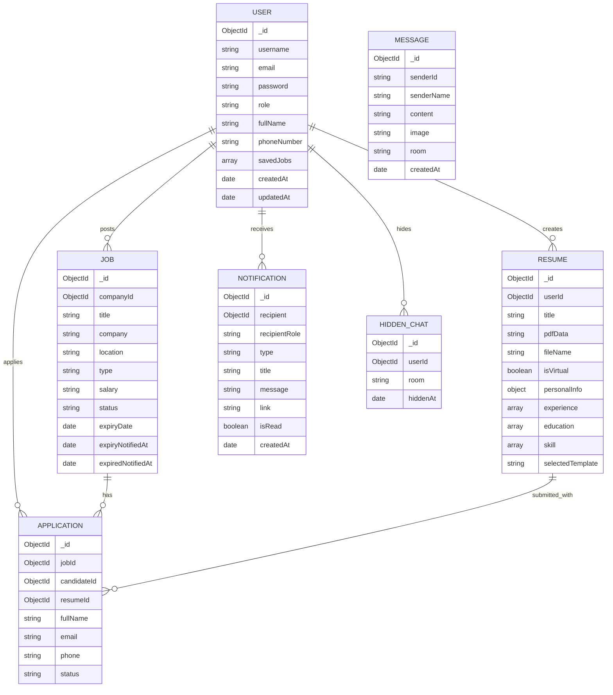
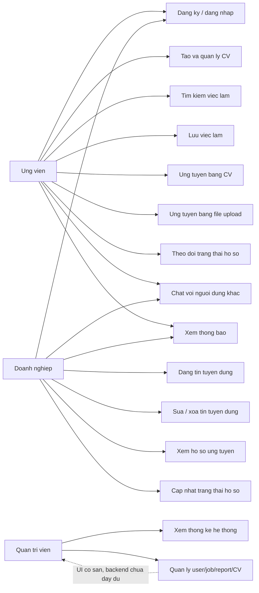
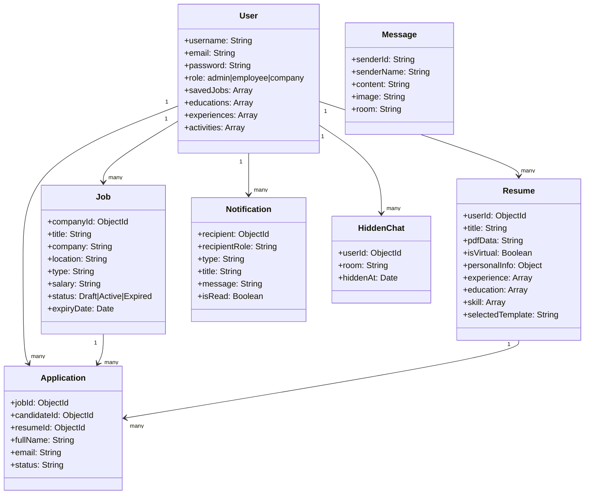
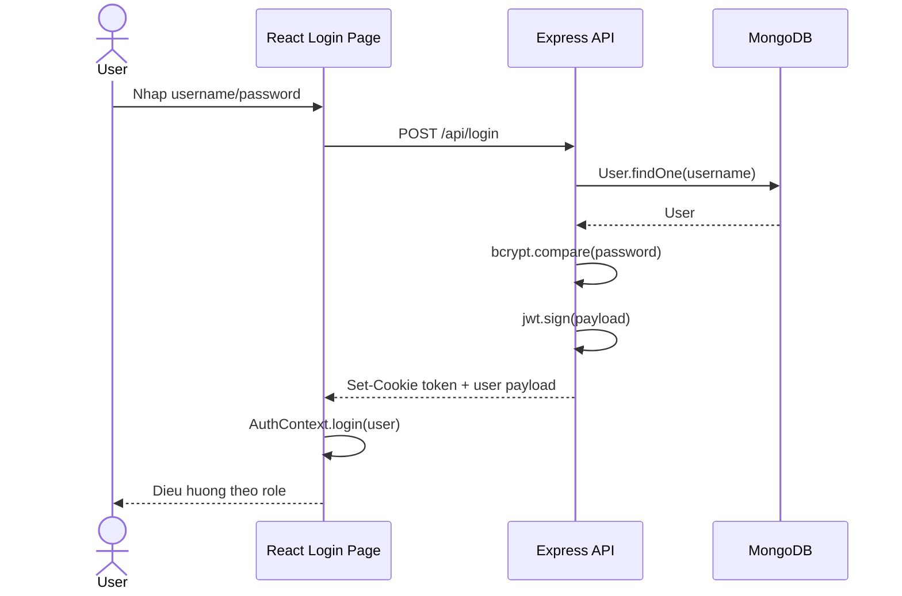
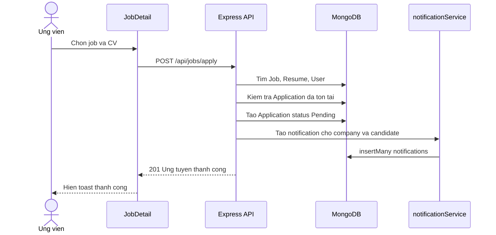
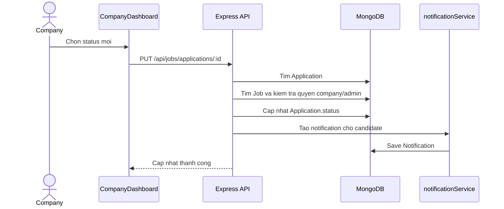
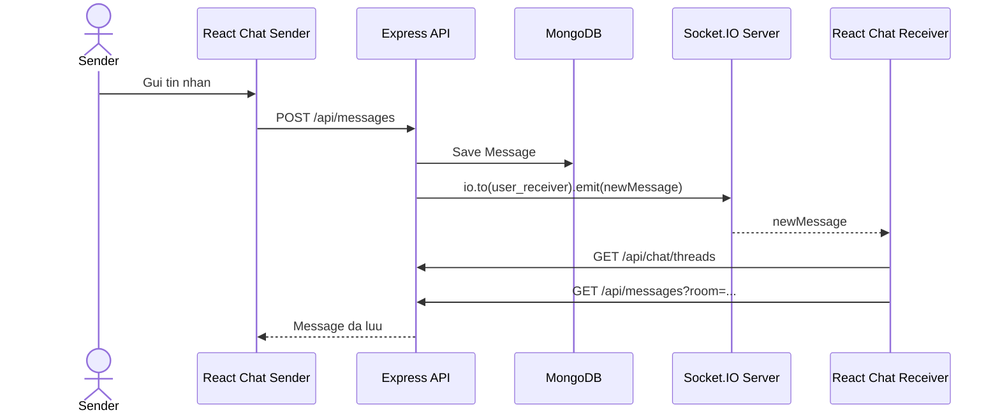
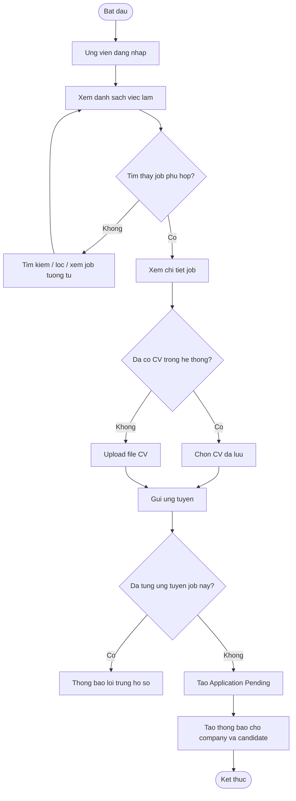
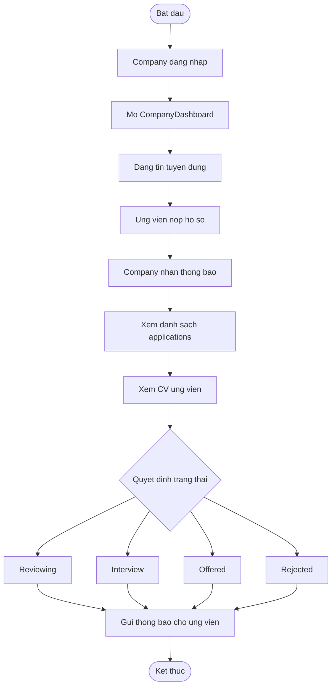

# Ban thao tai lieu phan tich project RabbitCV

## 1. Tong quan project

RabbitCV la ung dung web ho tro tao CV, tim viec, dang tuyen dung, ung tuyen va trao doi tin nhan giua ung vien va doanh nghiep. He thong duoc xay dung theo mo hinh full-stack JavaScript:

- Frontend: React 18, Vite, React Router, Tailwind CSS, Heroicons.
- Backend: Node.js, Express, MongoDB/Mongoose.
- Xac thuc: JWT luu trong HTTP-only cookie.
- Realtime: Socket.IO cho thong bao tin nhan moi.
- Tac vu nen: node-cron kiem tra tin tuyen dung sap het han/da het han.

Project co 3 nhom nguoi dung chinh:

- Ung vien/employee: tao CV, tim viec, luu viec, ung tuyen, theo doi trang thai ho so, nhan thong bao, chat.
- Doanh nghiep/company: dang tin tuyen dung, quan ly tin, xem CV ung vien, cap nhat trang thai ho so, nhan thong bao.
- Quan tri/admin: xem thong ke tong quan nguoi dung, doanh nghiep, viec lam, ho so ung tuyen. Mot so man hinh admin da co UI nhung backend route chua day du.

## 2. Cau truc project

```text
DA2/
  src/
    Pages/                 Cac man hinh React
    Components/            Component dung lai: Header, ChatBox, CV preview...
    context/               AuthContext, SavedJobsContext, SocketContext
    hooks/                 Hook thong bao, zoom CV, UI popup
    data/                  Du lieu mau cho job, news, CV
  server/
    server.js              Entry point backend, API routes, Socket.IO
    models/                Mongoose schema
    utils/                 Notification service
    cron/                  Cron job het han tin tuyen dung
  scripts/
    migrate-mongo.js       Script migration MongoDB
```

## 3. Cong nghe va thu vien

### Frontend

- `react`, `react-dom`: xay dung UI theo component.
- `react-router-dom`: dieu huong client-side.
- `vite`, `@vitejs/plugin-react-swc`: dev server va build frontend.
- `tailwindcss`, `@tailwindcss/vite`: styling utility-first.
- `@heroicons/react`: icon UI.
- `@tiptap/*`, `sass-embedded`: editor rich text va style SCSS cho thanh phan rich text.
- `socket.io-client`: ket noi realtime toi backend.

### Backend

- `express`: REST API.
- `mongoose`, `mongodb`: ket noi va thao tac MongoDB.
- `bcryptjs`: bam mat khau.
- `jsonwebtoken`: tao va xac thuc JWT.
- `cookie-parser`, `cookie`: doc cookie trong API va Socket.IO handshake.
- `cors`: cau hinh cross-origin va credentials.
- `socket.io`: realtime messaging.
- `node-cron`: job nen kiem tra han tuyen dung.
- `dotenv`: doc bien moi truong.

### Thu vien/chuc nang dang chu y

- Socket.IO duoc dung de bao tin nhan moi theo room rieng cua user: `user_<userId>`.
- Tiptap co trong dependencies, dung cho rich text editor.
- Cron job tu dong tao notification khi job sap het han trong 3 ngay hoac da het han.
- CV upload tu may tinh duoc luu dang base64 trong truong `pdfData` cua `Resume` ao (`isVirtual: true`).

## 4. Cach cai dat va chay project

### Bien moi truong

Tao file `.env` dua theo `.env.example`:

```env
PORT=5000
MONGODB_URI=mongodb+srv://<user>:<password>@<cluster>/RabbitCV?retryWrites=true&w=majority
JWT_SECRET=<replace-with-a-long-random-secret>
CLIENT_URL=https://rabbitcv.vercel.app
NODE_ENV=development
```

### Lenh chay

```bash
npm install
npm run start
npm run dev
```

- Backend Express chay o `http://localhost:5000`.
- Frontend Vite chay o `http://localhost:4000`.
- Vite proxy `/api` va `/socket.io` ve backend.

### Build production

```bash
npm run build
npm run preview
```

## 5. Cac chuc nang chinh

### 5.1. Xac thuc va phan quyen

- Dang ky tai khoan voi role `employee` hoac `company`.
- Dang nhap bang username/password.
- Mat khau duoc hash bang bcrypt.
- Sau khi dang nhap, server tao JWT va luu vao cookie `token`.
- Frontend dung `/api/me` de lay user hien tai.
- Role hien co: `admin`, `employee`, `company`.

### 5.2. Ho so nguoi dung

- Xem va cap nhat thong tin ca nhan: ho ten, dia chi, quoc gia, que quan, tuoi, ngay sinh, email.
- Cap nhat thong tin bao mat: email, so dien thoai, PIN.
- Doi mat khau co xac thuc mat khau cu.

### 5.3. Tao va quan ly CV

- Tao CV moi theo template.
- Sua CV da luu.
- Doi ten CV.
- Xoa CV.
- Xem CV theo id.
- CV gom thong tin ca nhan, bio, profile links, kinh nghiem, hoc van, ky nang, ngon ngu, chung chi, du an, giai thuong, so thich.
- Ho tro CV ao khi ung vien upload file PDF/DOC/DOCX luc ung tuyen.

### 5.4. Tim viec va ung tuyen

- Xem danh sach viec lam tu database ket hop du lieu mau trong `src/data/jobsData.js`.
- Tim kiem theo tu khoa, cong ty, dia diem, tag.
- Xem chi tiet viec lam.
- Luu/bo luu viec lam.
- Ung tuyen bang CV da luu.
- Ung tuyen bang file upload.
- He thong chan ung tuyen trung cung mot job qua unique index `{ jobId, candidateId }`.

### 5.5. Dashboard ung vien

- Xem danh sach ho so da ung tuyen.
- Theo doi trang thai: `Pending`, `Reviewing`, `Interview`, `Offered`, `Rejected`, `Accepted`.
- Xem viec lam da luu.
- Nhan thong bao lien quan ung tuyen.

### 5.6. Dashboard doanh nghiep

- Dang tin tuyen dung.
- Luu tin dang nhap/draft.
- Sua tin tuyen dung.
- Xoa tin tuyen dung va xoa cac application lien quan.
- Xem danh sach tin da dang.
- Xem danh sach ho so ung tuyen theo tung job.
- Cap nhat trang thai ho so ung tuyen.
- Nhan thong bao khi co ung vien moi.

### 5.7. Tin nhan realtime

- Chat phong chung `general`.
- Chat rieng theo room `private_<userId1>_<userId2>`.
- Lay thread chat gan nhat.
- An thread chat rieng bang collection `HiddenChat`.
- Gui tin nhan text hoac anh base64.
- Socket.IO bao su kien `newMessage` cho nguoi nhan.

### 5.8. Thong bao

- Lay so thong bao chua doc.
- Lay danh sach thong bao co phan trang.
- Danh dau mot thong bao da doc.
- Danh dau tat ca da doc.
- Xoa thong bao.
- Tao thong bao khi ung tuyen, doi trang thai application, job sap het han/da het han.

### 5.9. Admin

Backend hien co route `/api/admin/stats`:

- Tong so user.
- Tong so company.
- Tong so employee.
- Tong so job.
- Tong so application.
- Danh sach user, khong tra ve password.

Frontend co them cac man hinh AdminUsers, AdminJobs, AdminReports, AdminReviews, AdminSystemLogs. Tuy nhien, cac man hinh nay dang goi nhieu API chua thay khai bao trong `server/server.js`, vi du:

- `/api/admin/jobs`
- `/api/admin/users/:id/ban`
- `/api/admin/reports`
- `/api/admin/cvs`
- `/api/admin/logs`

Can bo sung backend neu muon cac trang admin nay hoat dong day du.

## 6. API chinh

### Auth/User

| Method | Endpoint | Mo ta |
| --- | --- | --- |
| GET | `/api/health` | Kiem tra server, env, MongoDB |
| POST | `/api/register` | Dang ky |
| POST | `/api/login` | Dang nhap, set JWT cookie |
| GET | `/api/me` | Lay user hien tai |
| POST | `/api/logout` | Xoa cookie token |
| GET | `/api/user/profile/:userId` | Xem profile user |
| PUT | `/api/user/profile` | Cap nhat profile |
| PUT | `/api/user/security` | Cap nhat email/phone/PIN |
| PUT | `/api/user/password` | Doi mat khau |

### Resume

| Method | Endpoint | Mo ta |
| --- | --- | --- |
| GET | `/api/resumes` | Lay CV cua user, bo qua CV ao |
| GET | `/api/resume/:id` | Lay chi tiet CV cua user |
| POST | `/api/resume` | Tao/cap nhat CV |
| DELETE | `/api/resume/:id` | Xoa CV |
| GET | `/api/resumes/view/:id` | Xem CV theo id |

### Jobs/Application

| Method | Endpoint | Mo ta |
| --- | --- | --- |
| GET | `/api/jobs` | Danh sach job active |
| GET | `/api/jobs/:id` | Chi tiet job |
| GET | `/api/jobs/my` | Job cua company dang nhap |
| POST | `/api/jobs` | Company tao job |
| PUT | `/api/jobs/:id` | Company/admin sua job |
| DELETE | `/api/jobs/:id` | Company/admin xoa job |
| POST | `/api/jobs/apply` | Ung tuyen bang CV da luu |
| POST | `/api/jobs/apply-file` | Ung tuyen bang file upload |
| GET | `/api/jobs/applications` | Company xem applications |
| GET | `/api/jobs/applications/mine` | Ung vien xem applications cua minh |
| PUT | `/api/jobs/applications/:id` | Cap nhat trang thai application |

### Chat/Notification/Saved Jobs

| Method | Endpoint | Mo ta |
| --- | --- | --- |
| GET | `/api/messages` | Lay tin nhan theo room |
| POST | `/api/messages` | Gui tin nhan |
| GET | `/api/chat/users` | Lay user de bat dau chat |
| GET | `/api/chat/threads` | Lay thread chat |
| PATCH | `/api/chat/threads/:room/hide` | An thread chat rieng |
| GET | `/api/notifications/unread-count` | Dem thong bao chua doc |
| GET | `/api/notifications` | Lay danh sach thong bao |
| PUT | `/api/notifications/:id/read` | Danh dau da doc |
| PUT | `/api/notifications/mark-all-read` | Danh dau tat ca da doc |
| DELETE | `/api/notifications/:id` | Xoa thong bao |
| GET | `/api/saved-jobs` | Viec da luu |
| POST | `/api/saved-jobs/:jobId` | Luu job |
| DELETE | `/api/saved-jobs/:jobId` | Bo luu job |

## 7. Co so du lieu

Database mac dinh: `RabbitCV`.

### Collections

- `users`
- `resumes`
- `jobs`
- `applications`
- `messages`
- `notifications`
- `hiddenchats`

### Mo hinh du lieu rut gon



### Index dang chu y

- `Application`: unique index `{ jobId: 1, candidateId: 1 }` de chan nop CV trung.
- `Notification`: compound index `{ recipient: 1, isRead: 1, createdAt: -1 }` de toi uu truy van thong bao.
- `HiddenChat`: unique index `{ userId: 1, room: 1 }`.
- `Job.companyId` va `Resume.userId` co index.

## 8. Use case diagram



## 9. Class diagram



## 10. Sequence diagram

### 10.1. Dang nhap



### 10.2. Ung tuyen bang CV da luu



### 10.3. Company cap nhat trang thai ho so



### 10.4. Chat rieng realtime



## 11. Activity diagram

### 11.1. Workflow tim viec va ung tuyen



### 11.2. Workflow doanh nghiep xu ly ho so



## 12. Deployment va van hanh

### Development

- Chay backend bang `npm run start` de nodemon theo doi `server/server.js`.
- Chay frontend bang `npm run dev`.
- Frontend goi API qua relative path `/api`, Vite proxy ve `localhost:5000`.
- Cookie auth can `credentials: include` o fetch.

### Production

- `vercel.json` cho thay project co y dinh deploy tren Vercel.
- Backend export default `app`, phu hop voi serverless deployment.
- Trong production, server khong `listen()` truc tiep vi co dieu kien `NODE_ENV !== "production"`.
- CORS cho phep `https://rabbitcv.vercel.app` va cac URL Vercel environment.

### Cron job

- `server/cron/jobExpiryCron.js` duoc import trong `server/server.js`.
- Cron chay moi ngay luc 00:00.
- Neu job con duoi 3 ngay het han va chua thong bao, tao notification `JOB_EXPIRING_SOON`.
- Neu job da het han va chua thong bao, tao notification `JOB_EXPIRED` va doi status sang `Expired`.

## 13. Review ky thuat va rui ro

### Diem tot

- Tach frontend/backend ro rang.
- Co auth context, saved jobs context va socket context giup frontend de quan ly state dung chung.
- Backend co middleware auth tap trung.
- Co index cho cac truy van quan trong nhu application trung, notification unread, hidden chat.
- Co cron job xu ly vong doi tin tuyen dung.
- Luong ung tuyen co tao notification cho ca hai phia.

### Diem can cai thien

- Nhieu chuoi tieng Viet trong code dang bi loi encoding/mojibake. Nen chuan hoa file ve UTF-8.
- `JWT_SECRET` co fallback mac dinh trong code. Production nen bat buoc cau hinh secret va khong dung fallback.
- Backend route admin chua khop voi frontend admin. Can bo sung API hoac dieu chinh UI.
- `server/server.js` dang chua qua nhieu route trong mot file lon. Nen tach route/controller/service theo domain: auth, users, resumes, jobs, applications, messages, notifications, admin.
- Upload CV/file dang luu base64 trong MongoDB, co the lam document phinh to. Nen can nhac luu file o object storage hoac GridFS.
- Mot so statistic tren `UserDashboard` dang hard-code, chua lay tu API.
- Route `/api/resumes/view/:id` cho phep user dang nhap xem resume bat ky theo id. Nen rang buoc quyen: chu CV, company cua job lien quan, hoac admin.
- CORS allowed origins dang hard-code kha nhieu. Nen tach thanh bien moi truong.
- Chua thay test tu dong cho API, auth, application flow, cron job.

## 14. De xuat nang cap

- Tach backend thanh cau truc:

```text
server/
  routes/
  controllers/
  services/
  middlewares/
  models/
  cron/
```

- Bo sung admin API con thieu.
- Them middleware `requireRole("admin")`, `requireRole("company")`.
- Them validation request body bang Zod/Joi.
- Them logging tap trung va error handler chung.
- Them test API voi Vitest/Jest + Supertest.
- Them storage rieng cho CV upload.
- Them realtime notification neu muon thong bao hien ngay, hien tai notification count dang polling moi 30 giay.

